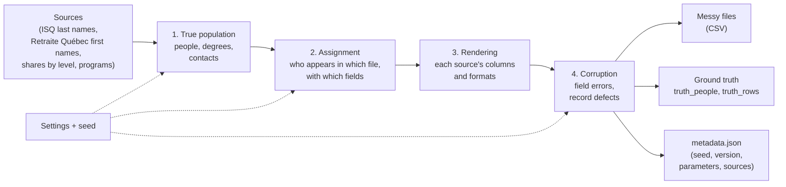

# Val-Lumière Synthetic Alumni Records

*A Québec benchmark for data quality and record linkage — design notes*

**Draft v0.2 — October 21, 2026.** Ibrahim Chegrane, written with Claude (Anthropic) from our design discussions. **Not yet built:** this document describes what will be generated and why. Every number below is a **proposal** until the generator exists and the choice is recorded in [DECISIONS.md](../../DECISIONS.md).

> **Fictional data.** Université de Val-Lumière does not exist. The generator invents every person. It uses public statistics (name frequencies, shares of international students) only as **proportions**, never as records about real people. Any resemblance to a real person is a coincidence of common names.

---

## 0. At a glance

| | |
|---|---|
| **What** | Synthetic alumni records of a fictional Québec university: a clean registrar file, and messy copies of the same people in the files an alumni office really receives (faculty spreadsheets, a newsletter list…) |
| **The key feature** | A hidden **ground truth**: for every messy row, which true person it is, and which errors were introduced. Cleaning and matching can therefore be **measured** |
| **What is realistic** | Last and first names drawn from **official Québec statistics**; a share of international students by level of study; errors modelled on **published research** and on what real files contain (accents, hyphens, initials, typos on neighbouring keys…) |
| **What it is for** | Learning and teaching data cleaning; testing duplicate detection and record linkage on French and Québec names; measuring whether matching works equally well for every group of names |
| **Sizes** | 2,000, 20,000 or 60,000 people; reproducible from a seed |
| **Safe by construction** | No real person, no real email domain, no telephone number that can exist |
| **Status** | Design notes. Version 1 of the generator is next |

---

## 1. Why this dataset

### 1.1 The need

The project [val-lumiere-alumni](../../README.md) builds the alumni database of a fictional university. Its [story](../story.md) starts from a real kind of mess: thirty years of faculty spreadsheets, a newsletter list, a reunion list, the same person two or three times under different spellings, a third of the emails dead. The database is ready. The next question is the one the story's Director really asks: **can we clean this mess, and prove how well we did?**

To answer it, we need messy data. And to *prove* anything, we need to know the **right answer**: which rows really are the same person.

### 1.2 Why not real data

Real alumni records are personal information. In Québec, their use is framed by the law on the protection of personal information (often called "Law 25" after the 2021 reform). A public, educational project cannot use them, and should not try.

### 1.3 Why not an existing public dataset

We looked at public datasets of students (on Kaggle) and at open-source alumni systems (on GitHub). They are useful for inspiration, but none fits:

| Need | Public student datasets | What we need |
|---|---|---|
| Matches an alumni office (degrees, contacts, lists from several sources) | No: grades, finances, generic fields | Yes |
| Québec context (names, French, accents, area codes) | No | Yes |
| **Ground truth** (which rows are the same person) | **No** | **Yes**: without it, cleaning cannot be measured |
| Clear origin and licence | Varies | Yes |

Research on record linkage uses synthetic data with ground truth for the same reason (section 13). We follow its principles, adapted to French and to Québec.

---

## 2. Who it is for, and what it is used for

| Users | Use |
|---|---|
| **Students and instructors** | Learn data cleaning and record linkage on realistic French data, with the answers available to check their work |
| **Practitioners** (alumni offices, CRM administrators, data teams) | Try a deduplication tool or a cleaning procedure on Québec names before using it on real files |
| **Researchers** | Measure matching methods on French and transliterated names, and compare results between groups of names |
| **This project** | Slice 4 of val-lumiere-alumni: clean the files, find the duplicates, load the result into the database, and report the quality |

**Tasks the dataset supports:**

1. **Linkage:** link each messy row to the right person of the registrar file.
2. **Deduplication:** find the rows that are the same person, inside one file and across files.
3. **Standardisation:** clean names, dates, phones and emails into one format.
4. **Blocking:** reduce the number of pairs to compare without losing true matches.
5. **Data quality measurement:** count and classify defects, before and after cleaning.

---

## 3. How we built it

This document comes out of conversations between Ibrahim Chegrane and Claude in October 2026. The *process* matters as much as the result:

1. **Start from the story**, not from the data: which files did the office really receive, from whom, in what state?
2. **Generate the truth first**: true (fictional) people, with their degrees and contacts.
3. **Then write messy copies** of them into several files, the way each source would really have produced them.
4. **Corrupt with realistic errors**, not random noise. Ibrahim's starting remark: "uniform random insertions, deletions and substitutions are blind to what people really do: someone typing O hits I or P, the neighbouring keys". This is section 8.
5. **Keep the truth aside**, in files the cleaning never reads, to measure it afterwards.
6. **Justify every proportion** with an official source when one exists, and say so plainly when one does not.

**Working rule.** The dataset could become a project of its own. To keep the main project moving, **version 1 contains only what slice 4 needs**; every other idea goes into a backlog (section 15).

---

## 4. A worked example

One true person, her three rows in three files, and what a matcher must do.

**The true person** (in `truth_people.csv`, never shown to the cleaning):

| true_person_id | first_name | last_name | birth_date | degree | student_number | email | phone |
|---|---|---|---|---|---|---|---|
| P000123 | Marie-Ève | Tremblay | 1974-03-12 | Baccalauréat en génie civil, 1996 | VL1992041 | marie-eve.tremblay@courriel.example | (819) 155-2041 |

**Her rows in the messy world:**

| File | Row | What it says | What happened |
|---|---|---|---|
| `registrar_degrees.csv` | 5120 | `VL1992041, Tremblay, Marie-Ève, 1974-03-12, Baccalauréat en génie civil, Génie, 1996` | Nothing: the reference |
| `faculty_engineering_1996.csv` | 17 | `Nom: Trembaly · Prénom: Marie Eve · Matricule: (empty) · Programme: Génie civil · Année: 1996 · Courriel: metremblay@courriel.example · Téléphone: 819 155-2041` | Last name: **transposition** (`bl` → `lb`) · first name: **hyphen** replaced by a space, **accent** dropped · student number **missing** · program under its **short name** · another email address (the person had two) · phone in **another format** |
| `newsletter_2019.csv` | 842 | `Courriel: marie-eve.tremblay@courriel.example · Nom complet: TREMBLAY Marie-Eve` | **Upper case**, family name **first**, accent dropped |

**The trap next to her.** The same files contain **Marie Tremblay**, born 1975, *Baccalauréat en enseignement*, 1997: a **different** person (P000124). Same last name, same first letter, almost the same age. A matcher that merges the two is wrong.

**Her rows in `truth_rows.csv`:**

| file | row | true_person_id | defects |
|---|---|---|---|
| registrar_degrees.csv | 5120 | P000123 | |
| faculty_engineering_1996.csv | 17 | P000123 | `last_name:typo.transposition; first_name:var.hyphen; first_name:var.accent_dropped; student_number:rec.missing; program:var.short_name; phone:fmt.phone` |
| newsletter_2019.csv | 842 | P000123 | `full_name:var.case; full_name:var.order_swapped; full_name:var.accent_dropped` |

**What a good matcher does:** links faculty row 17 and newsletter row 842 to `VL1992041`, and does **not** link Marie Tremblay's rows to her. The truth file says whether it succeeded, and **which defects** it handled or missed.

---

## 5. How the generator works

1. **True population.** For each person: sex and year of birth; a first name drawn from the names given that year (section 7.2); a last name drawn from Québec frequencies (7.1); one or more degrees consistent with the age (7.4); a student number; one or more emails built from the name; a phone number that cannot exist (7.5). Some people are international students (7.3).
2. **Assignment.** Each person appears in the registrar file (all degrees), and in 0 to 3 messy files, according to the settings: a faculty file for each faculty they graduated from (if that faculty's file covers their year), the newsletter list with some probability, and so on.
3. **Rendering.** Each source writes its own columns, headers and formats: the registrar's clean export; each faculty's own French headers; full name in one field in the newsletter list.
4. **Corruption.** Field errors (typos and systematic variants, section 8) and record defects (missing fields, duplicates inside a file, obsolete emails) are applied **with known probabilities**, and every change is written to `truth_rows.csv`.
5. **Outputs.** The messy CSV files, the two truth files, and `metadata.json`, which records the seed, the generator's version, every parameter, and the version of every source table.

---

## 6. The files, and what each column can carry

### 6.1 Overview

| File | In version 1 | Produced by | State |
|---|---|---|---|
| `registrar_degrees.csv` | ✅ | The registrar (official) | **Clean**: the reference |
| `faculty_<name>_<year>.csv` (two or three) | ✅ | Each faculty, in its own format | **Dirty** |
| `newsletter_2019.csv` | ✅ | The newsletter manager | Medium |
| `reunion_2018.csv` | later | The events coordinator | Dirty |
| `mailing_events.csv` | later | The mailing system (Office 365) | Clean, but out of date relative to the lists |
| `truth_people.csv`, `truth_rows.csv` | ✅ | The generator | **Hidden from the cleaning** |
| `metadata.json` | ✅ | The generator | Settings and versions |

**The key point for realism.** Emails and phones are **not** in the registrar's file; they are only in the messy files. So the work is to **link** each messy row to the right registrar person, most of the time without a student number.

### 6.2 Dictionary

**`registrar_degrees.csv`** — one row per degree. Machine export, English headers, UTF-8, ISO dates.

| Column | Meaning | Defects it can carry |
|---|---|---|
| `student_number` | The registrar's number, for life (`VL` + year of admission + sequence) | None |
| `last_name`, `first_name` | The name **at graduation** (a person who later changed name keeps the old one here) | None |
| `birth_date` | `YYYY-MM-DD` | None |
| `program`, `faculty` | Official French names (*Baccalauréat en génie civil*, *Génie*) | None |
| `graduation_year` | From 1965 | None |

**`faculty_<name>_<year>.csv`** — one row per graduate the faculty recorded. **Headers and formats differ by faculty**, as in real offices.

| Column (one possible header) | Meaning | Defects it can carry |
|---|---|---|
| `Nom` | Last name | Typos, accents, case, phonetic variants, name change, encoding |
| `Prénom` | First name | Typos, accents, hyphens, initials, encoding |
| `Matricule` | Student number | **Missing** (often in old files), mistyped |
| `Programme` | Program | **Short or local name** (*Génie civil*), not the official one |
| `Année` | Graduation year | Rarely off by one |
| `Courriel` | Email | Another address of the person, typo on the domain, obsolete address |
| `Téléphone` | Phone | Another format |

**`newsletter_2019.csv`** — one row per subscriber.

| Column | Meaning | Defects it can carry |
|---|---|---|
| `Courriel` | Email (the subscription key) | Typo, obsolete address |
| `Nom complet` | First and last name **in one field** | Case, order swapped, accents, initials |
| `Date d'inscription` | Sign-up date | Another format |

**`truth_people.csv`** — one row per true person: `true_person_id`, names, sex, birth date, origin group (local / international), status (alive / deceased), and the list of their degrees, emails and phones.

**`truth_rows.csv`** — one row per row of every messy file: `file`, `row`, `true_person_id`, `defects` (a list of `field:code`, with the codes of section 8.4).

**`metadata.json`** — seed, generator version, every parameter, and for each source table: its name, origin and download date.

---

## 7. Design choices, one by one

### 7.1 Last names: Québec frequencies

**Choice.** Draw last names according to their **real frequency in Québec**.

**Why.** Frequent names produce **homonyms** (several different people named Tremblay, born the same year), which is the real difficulty of matching: two rows with the same name are not always the same person. Close names (Dion / Dionne) add near-homonyms.

**Source.** Institut de la statistique du Québec (ISQ), *Les noms de famille au Québec* (Louis Duchesne), with tables of the 1,000 most frequent names. Order of magnitude: Tremblay about 81,500 people, Gagnon 59,800, Roy 57,000, Côté 52,300, Bouchard 40,100.

**Limit.** Figures from about 2005–2006, now archived. Acceptable: the distribution of family names changes slowly.

### 7.2 First names: by year of birth

**Choice.** Draw each person's first name according to the names **given in Québec in the year of their birth**, and by sex.

**Why.** Popular first names change with the decades; a 1965 graduate and a 2024 graduate do not have the same names. Compound names (Marie-Ève, Jean-François) are frequent and are a major source of variants (section 8).

**Source.** Retraite Québec, *Banque de prénoms* (girls and boys), on Données Québec, in CSV: every first name given each year since 1980, with its count. Licence CC BY 4.0 (credit: Retraite Québec). Names given to fewer than five children are hidden.

**Limit.** The bank **starts in 1980**, while graduates since 1965 were born from the 1940s on (open question 14.3).

### 7.3 International students

**Choice.** A share of graduates are international students, with names from their countries of origin. The share depends on the **level of study** and on the **year**.

**Why.** Bachelor's graduates are mostly from Québec; at master's and doctorate, international students are much more numerous. For matching, their names bring the hardest real cases: transliteration (Mohamed / Mohammed / Muhammad), family name written first, several given names.

**Sources.**
- ISQ: the share of international students among graduates rose from **12.2% (2013) to 21.0% (2023)**; in 2021, **36.7% at master's** and **38.9% at doctorate**.
- Bureau de coopération interuniversitaire (BCI): about **57,000** international students in Québec universities in fall 2024, **18%** of the student population.
- Gouvernement du Québec, *Portrait statistique des étudiants internationaux*: the countries of origin, to consult for version 2.

**In version 1?** No: backlog (section 15). Planned for version 2, with fairness measures (section 10.4).

### 7.4 Dates, degrees, student numbers

| Field | Rule |
|---|---|
| Birth date | Consistent with graduation: graduating between about 21 and 35 years old (older for graduate degrees) |
| Degrees | From a fictional list of programs and faculties, inspired by Québec universities; some people get two degrees |
| Graduation year | From 1965, the founding year of Val-Lumière |
| Student number | `VL` + year of admission + a sequence number (uppercase letters and digits) |

### 7.5 Contact information that can never belong to anyone

| Field | Rule | Why it cannot be real |
|---|---|---|
| Email | Built from the name as people really do (`marie-eve.tremblay@…`, `metremblay@…`, `mtremblay72@…`), on domains ending in **`.example`** | `.example` is reserved for documentation and can never be a real domain (RFC 2606) |
| Phone | Real Québec area codes (819, 873, 450, 514, 418), but an **exchange starting with 0 or 1**, for example `(819) 155-2041` | In the North American Numbering Plan, the 3-digit exchange never starts with 0 or 1, so such a number is never assigned (to verify in NANPA's documents) |

**Why not the famous 555 numbers?** Only 555-0100 to 555-0199 are reserved for fiction: 100 numbers per area code, 500 in total. For thousands of people, many would share a number, and two people sharing a phone look like duplicates: the data itself would create false clues. The exchange rule gives about 2 million numbers per area code, unique, in the right format, and impossible to dial.

---

## 8. The error model

There are three families, with different causes, so they need different models.

### 8.1 Typing errors, letter by letter

**Background.** Damerau (1964) observed that most misspellings are a **single** elementary error among four: substitution, deletion, insertion, and **transposition** of two adjacent letters. Levenshtein (1966) defined the distance counting the first three; adding transposition gives the Damerau–Levenshtein distance. Pollock and Zamora (1984), studying a large corpus of errors, reported that the **first letter** of a word is rarely wrong. Kukich (1992) surveys these results. *(Exact figures to verify in the papers before publication.)*

| Code | Error | Example | How it is generated |
|---|---|---|---|
| `typo.substitution_keyboard` | A key replaced by a **neighbouring** key | Tremblay → Trwmblay | A table: each key → its neighbouring keys |
| `typo.transposition` | Two adjacent letters swapped | Tremblay → Trembaly | Swap positions *i* and *i*+1 |
| `typo.deletion_double` | A doubled letter loses one | Pelletier → Peletier | Find a doubled letter, drop one |
| `typo.deletion` | A letter dropped | Gagnon → Gagon | Remove one letter |
| `typo.insertion` | A letter added | Gagnon → Gaggnon | Repeat a letter, or insert a neighbouring key |

**Position.** Lower probability on the first letter. **Count.** Usually one error per corrupted name, sometimes two.

### 8.2 Systematic variants

Not slips of the finger, but different ways of writing the same name, or traces of the tools. In real files they are often **more frequent than typos**, and a letter-by-letter model misses them completely.

| Code | Variant | Example | How it is generated |
|---|---|---|---|
| `var.accent_dropped` | Accents lost | Marie-Ève → Marie-Eve; Lévesque → Levesque | Unicode decomposition (`unicodedata.normalize('NFD')`), then remove the accent marks |
| `var.hyphen` | Hyphen, space, joined | Marie-Ève / Marie Ève / MarieEve | Replace or remove `-` |
| `var.case` | Case | TREMBLAY, tremblay | Upper or lower case |
| `var.initial` | Initials, abbreviations | M. Tremblay; J.-F. Côté | Keep the first letter, add a period |
| `var.order_swapped` | Family name first | "Tremblay Marie" | Swap the two parts |
| `var.phonetic` | French phonetic variants | Thibault / Thibeault; Gauthier / Gautier | A table of rewriting rules (`ault` ↔ `eault`, `th` ↔ `t`, é / è / ê / e…) |
| `var.transliteration` | International names (version 2) | Mohamed / Mohammed / Muhammad | A table of variant groups |
| `var.name_change` | Name changed since graduation | Sophie Gagnon, now Roy | Replace the last name in some files only |
| `var.short_name` | Local name of a program | *Génie civil* for *Baccalauréat en génie civil* | A table: official name → local names |
| `var.encoding` | Encoding error (version 2) | é → é ("édouard") | Encode in UTF-8, decode as Windows-1252 |
| `fmt.date`, `fmt.phone` | Other formats | `01/06/1998`, `juin 1998`; `(819) 155 2041` | Several formatting functions, one drawn at random |
| `email.typo_domain`, `email.obsolete` | Dirty emails | `courriel.exmaple`; an address that bounces | Typo on the domain; an old address replaced by a new one |

### 8.3 Record-level defects

| Code | Defect |
|---|---|
| `rec.missing` | A field left empty (student number in old faculty files, birth date) |
| `rec.duplicate_in_file` | The same person twice in the same file |
| `rec.deceased_not_flagged` | A deceased person still listed as active |

### 8.4 Why codes

Every defect has a **code**, written in `truth_rows.csv`. It makes the results readable **by kind of defect**: "the method catches 98% of dropped accents but only 60% of name changes" is far more useful than one global score.

**Related work.** The GeCo generator (Christen and Vatsalan, 2013) and the generator behind FEBRL use the same families of "corruptors" (keyboard, phonetic, OCR). Our contribution is the adaptation to **French and Québec**: accents, compound first names, French phonetics, the Canadian French keyboard, local and international names, and the sources an alumni office really receives.

---

## 9. Parameters, sizes, reproducibility

Everything is in one settings file, with a **seed**: the same seed always produces the same data, so results and tests are reproducible.

| Parameter | Proposal (to decide) |
|---|---|
| Number of times one person appears in the messy files | 0 (35%), 1 (40%), 2 (20%), 3 or more (5%): the story's "two or three times" |
| Probability that a name has a defect | about 30% |
| Among defects | about 60% systematic variants, 40% typos |
| Typos per corrupted name | 1 (85%), 2 (15%) |
| Student number present in faculty files | 1990s: 10%; 2010s: 70% |

| Size | People | Use |
|---|---|---|
| small | 2,000 | Tests and development: seconds |
| medium | 20,000 | Intermediate |
| full | **60,000** | **The story's number** |

60,000 people make the real problem appear: comparing every pair of records means about **1.8 billion** comparisons. Matching at that scale needs **blocking** (comparing only plausible candidates), a core topic of record linkage (Christen, 2012).

**Traceability.** Every source table is stored with its origin and download date; `metadata.json` records the seed, the parameters and the generator's version, so any result can be traced to the exact data it used.

---

## 10. How to measure with it

### 10.1 Linkage and deduplication

A method proposes **links** (this messy row is that registrar person) or **pairs** (these two rows are the same person). The truth file says which are right.

| Measure | Question it answers |
|---|---|
| **Precision** | Of the links proposed, how many are right? (Low precision: different people merged, like the two Marie Tremblay) |
| **Recall** | Of the true links, how many were found? (Low recall: duplicates left behind) |
| **F1** | One number balancing the two (their harmonic mean) |

### 10.2 Blocking

| Measure | Question it answers |
|---|---|
| **Pairs completeness** | Of the true matching pairs, how many survive the blocking? |
| **Reduction ratio** | Of all possible pairs, how many does the blocking avoid comparing? |

A good blocking keeps almost every true pair while avoiding almost all comparisons (Christen, 2012).

### 10.3 By kind of defect

Recall computed separately for each defect code (section 8.4).

### 10.4 By group of names (version 2)

The same measures for local and for international names. A method that works much better for one group than for the other is unfair to the people of the other group; the dataset should make this visible.

### 10.5 Baselines (to publish with version 1)

To give a reference point, simple methods measured on the dataset: exact match on normalised name and year; edit distance (Levenshtein, Damerau–Levenshtein) with a threshold; the Jaro–Winkler similarity (Jaro, 1989; Winkler, 1990), widely used for names.

---

## 11. Checking realism

Before a version is released, the generator produces a short report comparing what it made with what it claims:

| Check | Compared with |
|---|---|
| Frequency of the 50 most common last names | The ISQ table |
| Most common first names by decade of birth | The Retraite Québec bank |
| Age at graduation, by level | The rule of section 7.4 |
| Share of international students by level (version 2) | ISQ and BCI figures |
| Rate of each defect actually applied | The parameters |
| **Homonyms**: how many true people share the same full name and birth year | Reported, because it measures how hard the dataset is |
| Distribution of copies per person | The parameters |

---

## 12. Limits and ethics

- **Synthetic, not real.** The data imitates statistical properties; it does not describe real people. Matching quality measured on it is an estimate, not a guarantee on real files.
- **Sources have limits:** last names from about 2005; first names only since 1980; international shares by period, not by university.
- **Coincidences.** Common names drawn with plausible dates may coincide with a real person (a "Marie Tremblay, born 1975" certainly exists). No real record is used or linked; the documentation says so.
- **Licences of the sources** must be respected and credited (Retraite Québec data: CC BY 4.0; ISQ: their terms of reuse, to check).
- **Fairness.** Names of different origins are not equally easy to match. The dataset should make this measurable, not hide it.
- **No real contact data:** reserved email domains; phone numbers that cannot exist.

---

## 13. Related work

| Work | What it is | Difference with ours |
|---|---|---|
| FEBRL (Christen, 2008) | A record linkage system with a data generator, and benchmark datasets with ground truth (also distributed with the Python library `recordlinkage`) | English-language names and Australian-style records |
| GeCo (Christen and Vatsalan, 2013) | A flexible generator and "corruptor" of personal data | General-purpose; the language and the error tables are to be supplied |
| Synthea | Synthetic patient records, for health care | Another domain; no focus on messy copies from several sources |
| Kaggle student datasets | Synthetic or anonymous student tables | No ground truth, not an alumni office, not Québec |
| Open-source alumni systems (GitHub) | Applications to manage alumni | Software, not data |

**What is new here:** French and Québec names from official statistics; the files an alumni office really receives; a coded taxonomy of defects; a ground truth per row; and, in version 2, international names and fairness measures.

---

## 14. Open questions

1. **Keyboard layout** for neighbouring-key typos: Canadian French (the common layout in Québec, more faithful) or American QWERTY (simpler)?
2. **Defect rates** (section 9): keep the proposals, or other values?
3. **First names before 1980:** find an older source (the ISQ has published work on first names in Québec), or approximate with the earliest years available, and say so?
4. **The list of programs and faculties:** fictional, but inspired by which real lists?
5. **Licence of the dataset itself:** CC BY 4.0, like the documentation?
6. **Its own repository:** when (after version 1 has been used by slice 4)?

---

## 15. Scope: version 1 and the backlog

**Test question for any idea:** does slice 4 (cleaning and duplicate detection) need it to work? If not, it goes into the backlog.

| Version 1 (for slice 4) | Backlog (later) |
|---|---|
| Québec last and first names (7.1, 7.2) | International students and transliteration (7.3) |
| Degrees, dates, student numbers (7.4) | Encoding errors, every format |
| Registrar file, two or three faculty files, newsletter list | Reunion list, mailing-system events |
| Typos (8.1) and the main variants (accents, hyphens, case, initials, order, short names, name change) | French phonetics, Canadian French keyboard |
| Ground truth with defect codes; the realism report; baselines | 60,000 version; fairness measures; own repository; publication |

---

## 16. Versions and citation

*To write when version 1 exists:* version numbers (major.minor), a changelog, the licence of the data, and a "how to cite" entry.

---

## Glossary

| Term | Meaning |
|---|---|
| **Ground truth** | The right answer, known in advance: here, which rows are the same person |
| **Record linkage** | Finding the records, in different sources, that refer to the same entity (here, a person) |
| **Deduplication** | The same, inside one source |
| **Blocking** | Comparing only plausible candidate pairs, instead of every pair |
| **Precision, recall, F1** | How many proposed links are right; how many true links are found; a balance of the two |
| **Benchmark** | A shared dataset, with a known answer, on which methods are measured and compared |
| **Seed** | The number that starts the random generator: the same seed gives the same data |
| **Transliteration** | Writing a name from another alphabet in Latin letters, often in several ways |
| **Mojibake** | Garbled characters from a wrong encoding (é shown as é) |

---

## References

**Statistics and data sources**
- Institut de la statistique du Québec, *Les noms de famille au Québec* (L. Duchesne). <https://statistique.quebec.ca/fr/document/noms-de-famille-au-quebec>
- Institut de la statistique du Québec, *Noms de famille au Québec : aspects statistiques et distribution spatiale*. <https://statistique.quebec.ca/fr/document/noms-de-famille-au-quebec-aspects-statistiques-et-distribution-spatiale>
- Article citing the ISQ figures (Érudit). <https://www.erudit.org/en/culture/hq1056841/hq050/66162ac.pdf>
- Retraite Québec, *Banque de prénoms – Filles*, Données Québec (CC BY 4.0). <https://donneesquebec.ca/recherche/fr/dataset/banque-de-prenoms-filles>
- Retraite Québec, *Banque de prénoms – Garçons*, Données Québec (CC BY 4.0). <https://www.donneesquebec.ca/recherche/fr/dataset/banque-de-prenoms-garcons>
- Retraite Québec, *Banque de prénoms*. <https://www.retraitequebec.gouv.qc.ca/en/services-en-ligne-outils/banque-de-prenoms/Pages/banque-de-prenoms.aspx>
- Institut de la statistique du Québec, graduates with a bachelor's degree or higher, 2023. <https://statistique.quebec.ca/en/fichier/diplomes-baccalaureat-et-superieur-2023.pdf>
- Institut de la statistique du Québec, *En 2021, plus de femmes que d'hommes au doctorat*. <https://statistique.quebec.ca/fr/communique/2021-plus-femmes-que-hommes-doctorat>
- Bureau de coopération interuniversitaire, enrolments, fall 2024. <https://bci-qc.ca/wp-content/uploads/2024/10/Inscriptions_automne2024.pdf>
- Gouvernement du Québec, *Portrait statistique des étudiants internationaux*. <https://www.quebec.ca/education/indicateurs-statistiques/enseignement-superieur/etudes-statistiques/portrait-statistique-etudiants-internationaux>

**Contact data that cannot be real**
- D. Eastlake, A. Panitz, *Reserved Top Level DNS Names*, RFC 2606, 1999 (`.example`).
- North American Numbering Plan Administration (NANPA): numbering rules (to verify: exchanges never start with 0 or 1). <https://www.nationalnanpa.com/>
- *555 (telephone number)* and *Fictitious telephone number*, Wikipedia (the reserved range 555-0100 to 555-0199). <https://en.wikipedia.org/wiki/555_(telephone_number)>, <https://en.wikipedia.org/wiki/Fictitious_telephone_number>

**Errors, string similarity and record linkage** *(to verify: exact pages and figures)*
- F. J. Damerau, "A technique for computer detection and correction of spelling errors", *Communications of the ACM*, 7(3), 1964.
- V. I. Levenshtein, "Binary codes capable of correcting deletions, insertions, and reversals", *Soviet Physics Doklady*, 10(8), 1966.
- J. J. Pollock, A. Zamora, "Automatic spelling correction in scientific and scholarly text", *Communications of the ACM*, 27(4), 1984.
- K. Kukich, "Techniques for automatically correcting words in text", *ACM Computing Surveys*, 24(4), 1992.
- I. P. Fellegi, A. B. Sunter, "A theory for record linkage", *Journal of the American Statistical Association*, 64(328), 1969.
- M. A. Jaro, "Advances in record-linkage methodology as applied to matching the 1985 census of Tampa, Florida", *Journal of the American Statistical Association*, 84(406), 1989.
- W. E. Winkler, "String comparator metrics and enhanced decision rules in the Fellegi–Sunter model of record linkage", *Proceedings of the Section on Survey Research Methods*, American Statistical Association, 1990.
- P. Christen, *Data Matching: Concepts and Techniques for Record Linkage, Entity Resolution, and Duplicate Detection*, Springer, 2012.
- P. Christen, "Febrl: an open source data cleaning, deduplication and record linkage system with a graphical user interface", KDD 2008 (demonstration).
- P. Christen, D. Vatsalan, "Flexible and extensible generation and corruption of personal data", CIKM 2013.
- J. de Bruin, *Python Record Linkage Toolkit* (`recordlinkage`), documentation. <https://recordlinkage.readthedocs.io/>
- Synthea, synthetic patient generator (MITRE). <https://synthetichealth.github.io/synthea/>

---

*Licence of this document: CC BY 4.0 (see [LICENSE-DOCS](../../LICENSE-DOCS)).*
