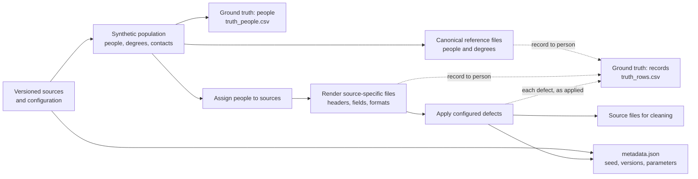

# Val-Lumière Graduates

*A design proposal for a synthetic Québec dataset for data quality, deduplication, and record linkage*

**Author:** Ibrahim Chegrane  
**Version:** 0.4 — 21 October 2026  
**Status:** Design proposal. The generator has not yet been implemented; every parameter below is a proposal until it has been implemented, measured on the output, and recorded.

> **Synthetic-data notice.** Université de Val-Lumière is an invented setting, not a representation of a real university. The planned generator will create records synthetically; it will not copy records about real people. Public statistics guide aggregate distributions only, never individual records. Common names and plausible birth dates may coincidentally resemble those of real people. Contact details are non-real by construction: email addresses use the reserved `.example` domain, and telephone numbers use an exchange pattern that the North American Numbering Plan never assigns.

## Abstract

This document proposes a reproducible generator for synthetic records of the graduates of a fictional Québec university. The generator will produce a clean person register, degree records, and source-specific copies of the same people resembling the files an alumni office receives from faculties and mailing lists. Those copies will contain configurable, labelled defects: missing identifiers, spelling variants, format differences, and duplicate records. Separate ground-truth files will identify the fictional person behind each record and every defect deliberately introduced, so that linkage and data-quality methods can be evaluated rather than merely demonstrated. Public Québec statistics inform the name distributions where their coverage is suitable, and the documentation distinguishes sourced distributions from approximations. The outputs are intended for teaching, for testing tools before they touch real files, and, once baselines exist, for comparing methods.

**Keywords:** synthetic data; data quality; record linkage; entity resolution; deduplication; Québec French; ground truth; reproducibility.

## 1. Introduction and scope

### 1.1 The problem

The fictional university's alumni office has accumulated graduate records over many years. Its files come from different systems and teams: a registrar's export, faculty spreadsheets, newsletter lists. They differ in structure and quality. They may omit student numbers, use local program names, spell names differently, store names in different orders, or contain outdated contact details. The same person may appear several times, while two different people may have very similar names.

A database can store the cleaned result, but it cannot by itself demonstrate that the cleaning and matching were accurate. To measure accuracy, an evaluator needs to know, before applying a method, which records represent the same underlying person. This proposal therefore pairs synthetic source records with a separate, generated ground truth.

### 1.2 Terminology and boundaries

A **university graduate** is a person who has completed at least one university degree. The term does not mean a *graduate student* currently enrolled in master's or doctoral studies. People who attended the university but left without a degree are outside the initial scope. The word *alumni* is sometimes understood more broadly; the subtitle and this definition make the intended population explicit.

A **dataset** is the collection of records made available for use. A **benchmark** requires more: defined tasks, ground-truth labels, evaluation metrics, a reproducible protocol, and reference results. The generator is intended to produce a dataset that can support such a benchmark; it becomes one only once those elements exist and have been validated (section 13).

Version 1 focuses on linking and deduplicating person records across sources. Degrees support matching but are modelled separately, because one person can earn more than one degree. Every generated person has one row in the canonical register; records with no counterpart in the register are a separate evaluation case, planned as an option (section 10.1).

The documentation follows the questions of *Datasheets for Datasets*, a widely cited framework for documenting a dataset's motivation, composition, collection process, intended uses and maintenance [1].

### 1.3 Intended uses

The data is intended for learning and teaching data cleaning; testing deduplication and record-linkage procedures; comparing standardisation and blocking methods; measuring defects before and after cleaning; and examining how matching difficulty varies across names and record types. Practitioners can try tools on fictional Québec-oriented data before working with real files. Its first user is the open-source database project *val-lumiere-alumni*, which loads the cleaned result into a PostgreSQL schema with consent and data-protection rules.

The initial tasks are:

- **Record linkage:** link a source record to the corresponding person in the canonical register.
- **Deduplication:** identify records that represent the same person within a source and across sources.
- **Standardisation:** normalise names, dates, telephone formats, email addresses and program labels, keeping the original values for auditability.
- **Blocking:** reduce the number of candidate pairs while retaining true matches.
- **Data-quality measurement:** measure missingness, formatting defects, obsolete contacts and duplicates before and after processing.

## 2. Why synthetic data, and how this proposal relates to existing work

### 2.1 Why not real alumni records

Alumni records contain personal information. Using or publishing them requires an appropriate legal basis, institutional authorisation and proportionate safeguards. A public educational project takes the safer route: it generates fictional records and uses no private alumni file as input.

Synthetic data is not automatically realistic. Its value depends on how its distributions, source structures, errors and limitations are documented and tested. The ground truth makes it possible to evaluate a method against the generator's known answers; it does not prove that the generator captures every difficulty of a real institution.

### 2.2 Related datasets and tools

Existing datasets and tools address parts of the problem, with different aims. The comparison below is focused, not exhaustive.

| Resource | Main purpose | What it shares with this proposal | Difference in scope |
|---|---|---|---|
| *Student Performance*, UCI [2] | Predict secondary-school performance in two Portuguese schools | A well-documented educational dataset | Designed for prediction, not for matching messy records across sources |
| *Predict Students' Dropout and Academic Success*, UCI [3] | Classify outcomes of higher-education students | Assembled from several separate databases | Outcome prediction; no person-linkage ground truth |
| Student tables on Kaggle [4, 5, 6] | Small tables of students' names, contact details or academic information | Student-oriented fields usable for cleaning exercises | No ground truth across sources; licences and provenance to verify case by case |
| FEBRL and its datasets [7] | Record linkage and deduplication, with known links | A direct precedent: generated records with known matches | Different population and domain; not Québec French names or alumni-office files |
| GeCo [8] | Generate personal data and apply configurable corruptions | Modular generation and explicit corruption functions | General-purpose; not tailored to graduate records or a Québec error catalogue |
| Synthea [9] | Synthetic patient populations and health records | Configuration, reproducibility, synthetic records | Health care, not person matching across alumni-office files |

Open-source alumni-management applications also exist, for example [10, 11]; they are software for managing alumni, not data for evaluating matching. The contribution of this proposal is therefore specific: graduate-oriented source formats, Québec French name variation, controlled and coded defects, and ground truth that supports both linkage and defect-level evaluation.

## 3. Design choices

### 3.1 One person, separate degree records

The generator creates one canonical person record for each fictional graduate and a separate record for each degree. A person's identity is not repeated because they earned several degrees, and the linkage task has a single target per person. The register is therefore split into `registrar_people.csv` (one row per person) and `registrar_degrees.csv` (one row per degree, linked by the synthetic student number).

### 3.2 Ground truth comes first

The generator creates a hidden synthetic population first, then renders each person into source-specific files and records every deliberate variation. The truth is therefore not reconstructed after the fact: it is the starting point, and the source files are derived from it. The matching method never reads the truth files; they describe the answer, not the clues.

### 3.3 Real-world structure, not uniform noise

Uniform random character edits are blind to how records actually go wrong. A person typing *o* tends to hit a neighbouring key such as *i* or *p*; an old faculty spreadsheet omits the student number; a newsletter list puts the family name first; one system drops accents. The generator therefore combines character-level typos, informed by the classic studies of spelling errors [12, 13, 14], with systematic variations, stale contacts, missing fields and genuine homonyms. Those studies motivate the categories of error; they do not provide measured rates for Québec personal names, so the rates remain configuration parameters (section 9).

### 3.4 Statistics used within their limits

Each official source has a coverage period, a population and a collection method. These limits are recorded with each downloaded source, carried into the realism report, and stated in section 12. Where no suitable official distribution exists, the generator uses a labelled approximation, never presented as an official statistic.

### 3.5 Reproducibility and provenance

A configuration file and a random seed control the population size, the assignment to sources and the corruption. With the same generator version, source snapshots, configuration and seed, the generator reproduces the same records and ground truth. `metadata.json` records these inputs, with source URLs, download dates, licences, row counts and checksums: reproducibility depends on preserving the source snapshots, not only the seed.

### 3.6 Stable record identifiers

Every record carries an opaque, generated `record_id`, repeated in the ground truth. A row number is not enough: sorting a file changes it. Each identifier is drawn independently for each record, reproducibly from the seed, and is never derived from the person's identifier or from a sequence shared by one person's records: otherwise two records of the same person would share a suffix, and the identifier would leak the answer. A prefix may name the source file, which is no secret. The identifier lets an evaluator join a method's output to the truth; a matching method must not use it as a feature.

## 4. A worked example

One invented person, her records in four files, and what a matcher must do.

**The underlying person** is Marie-Ève Tremblay, born on 12 March 1994, with synthetic student number `VL2012041`. She earned a bachelor's degree in civil engineering in 2016 and has two email addresses.

| Source file | Example record | What the record illustrates |
|---|---|---|
| `registrar_people.csv` | `record_id: RP-7F3A91 · VL2012041, Marie-Ève, Tremblay, 1994-03-12` | The clean, person-level reference |
| `registrar_degrees.csv` | `record_id: RD-C42E08 · VL2012041, Baccalauréat en génie civil, Génie, 2016` | One degree; a person can have several such rows |
| `faculty_engineering_2016.csv` | `record_id: FE2016-8A17D4 · Matricule: (empty) · Nom: Trembaly · Prénom: Marie Eve · Programme: Génie civil · Année: 2016 · Courriel: metremblay@courriel.example · Téléphone: 819 155-2041` | Student number missing; a transposition in the family name; hyphen replaced by a space and accent dropped in the first name; a short program label; another phone format; her second email address |
| `newsletter_2019.csv` | `record_id: NL2019-B8421F · Courriel: marie-eve.tremblay@courriel.example · Nom complet: TREMBLAY Marie-Eve` | Family name first, upper case, accent dropped |

The same sources also contain **Marie Tremblay**, born in 1995, with a different degree in 2017. She is a different synthetic person: a matcher that links her records to Marie-Ève has made a false match, even though the names are close.

The ground truth identifies the person behind each record and every defect introduced:

| source file | record_id | true_person_id | defect codes |
|---|---|---|---|
| `registrar_people.csv` | `RP-7F3A91` | `P000123` | *(none)* |
| `registrar_degrees.csv` | `RD-C42E08` | `P000123` | *(none)* |
| `faculty_engineering_2016.csv` | `FE2016-8A17D4` | `P000123` | `last_name:typo.transposition`; `first_name:var.hyphen`; `first_name:var.accent_dropped`; `student_number:rec.missing`; `program:var.short_name`; `phone:fmt.phone` |
| `newsletter_2019.csv` | `NL2019-B8421F` | `P000123` | `full_name:var.case`; `full_name:var.order_swapped`; `full_name:var.accent_dropped` |

The four record identifiers share nothing with each other or with `P000123`: only the ground truth connects them. The student number `VL2012041`, by contrast, is shared on purpose: it is evidence a matcher may use, when a source provides it.

A successful method links the faculty and newsletter records to `P000123` and keeps Marie Tremblay separate. The ground truth scores the result, and shows which defects the method handled or missed.

## 5. Name sources and population calibration

### 5.1 Family names: a useful but dated Québec distribution

The Institut de la statistique du Québec (ISQ) published *Les noms de famille au Québec : aspects statistiques et distribution spatiale* [15], with tables of the most frequent family names; the ISQ page presents estimates for 2005, and the tables of the 1,000 most frequent names are archived (24 May 2006) [16]. The order of magnitude is telling: about 81,500 people named Tremblay, 59,800 Gagnon, 57,000 Roy. This Québec-specific distribution produces the common names and homonyms that make matching hard.

The source is a single snapshot, not an annual series from 2000 to 2025, and no comparable recent table has been identified. Version 1 therefore uses it as a fixed historical distribution and says so; the generator does not invent year-by-year changes by interpolating values that were never published. A newer comparable source, if one is found, will enter as a new versioned input rather than silently replacing this one.

### 5.2 First names: annual data from 1980 to 2025

Retraite Québec's *Banque de prénoms* provides first-name counts by year from 1980 to 2025, in separate datasets for girls and boys, under a CC BY 4.0 licence [17, 18]. It covers children eligible for family benefits, born in Québec or having immigrated to Québec: a useful frequency source, not a complete register of births. Counts for names given to fewer than five children are suppressed, and names given only once over the whole period are removed; the generator never treats the string `<5` as a name or invents the suppressed counts.

The source does not cover births before 1980, while graduates since 1965 were born from the 1940s on. Before version 1 claims year-specific sampling for those cohorts, one of three approaches must be chosen and documented: a suitable historical source; a clearly labelled period-level approximation, reported separately; or a calibrated population restricted to supported birth years.

### 5.3 International names and student shares

The share of international students among graduates is substantial and rising. According to the ISQ, the share of Québec university degree recipients who were international students rose from 12.2% in 2013 to 21.0% in 2023 [19]; in 2021 they represented 36.7% of second-cycle and 38.9% of third-cycle degree recipients [20]. These figures concern **degrees awarded**, not enrolment; the two measure different populations and must not be substituted for each other.

International names bring the hardest real cases for matching: transliteration variants, family name first, several given names. They are planned for version 2, where the figures above will calibrate the share of international graduates by level and period. Group labels will come from the generator's own synthetic metadata, never inferred from a name.

### 5.4 Degrees and programs

Degrees are generated from a fictional list of programs and faculties inspired by Québec university terminology. A person may earn one or more degrees; birth and graduation dates follow plausible age ranges, wider for graduate degrees. Graduation years start in 1965, the founding year of the fictional university. Student numbers follow a reproducible format: `VL`, the year of admission, and a sequence number.

### 5.5 Contact data that is non-real by construction

Every generated email address ends in `.example`, a domain reserved for documentation [21]. A typo in a domain must keep that ending: `courriel.example` may become `courriel.exampel.example`, never `courriel.exmaple`, which would leave the reserved domain.

Telephone numbers use a Québec area code (819, 873, 450, 514, 418) with a deliberately invalid exchange. In the North American Numbering Plan's `NXX-NXX-XXXX` format, `N` is a digit from 2 to 9 [22], so an exchange starting with 0 or 1, as in `819-155-2041`, is never assigned. This gives about two million distinct numbers per area code, in a realistic format. The reserved fictional range 555-0100 to 555-0199 offers only 100 numbers per area code: thousands of people would share them, and shared numbers would create false duplicates.

## 6. How the generator works

The generator proceeds in stages; each takes explicit inputs and writes outputs that can be validated on their own.

The **population** stage creates the synthetic people with their degrees and contacts. The **assignment** stage decides which sources contain each person: a faculty file for each faculty and year they graduated from, the newsletter list with some probability. The **rendering** stage gives each source its own column names, field combinations and formats: the registrar uses official program names and ISO dates, a faculty spreadsheet French headers and short program names, the newsletter list a single full-name field. The **corruption** stage applies the configured defects. The ground truth is written in two parts, and never reconstructed from the messy files: `truth_people.csv` comes straight from the population, before any source exists; `truth_rows.csv` is written by the rendering and corruption stages at the moment each record is created and each defect applied (dotted arrows). The source files given to a method contain no `true_person_id` and no annotation.

## 7. File formats

| File | One row represents | Content |
|---|---|---|
| `registrar_people.csv` | One synthetic graduate | `record_id`, student number, canonical first and last names, birth date |
| `registrar_degrees.csv` | One degree | `record_id`, student number, program, faculty at graduation, graduation year, name printed on the diploma |
| `faculty_<name>_<year>.csv` | One person as recorded by a faculty | `record_id`, faculty-specific headers and formats, names, optional student number, program, contacts. Defects may be present |
| `newsletter_<year>.csv` | One subscriber | `record_id`, email, full name in one field, sign-up date. May be duplicated or outdated |
| `truth_people.csv` | One underlying synthetic person | `true_person_id`, identity attributes, degree and contact relationships, status fields. Not an input to cleaning |
| `truth_rows.csv` | One record of a generated file | Source file, `record_id`, record type, `true_person_id`, defect codes. Not an input to cleaning |
| `metadata.json` | One generated package | Generator and data versions, seed, configuration, source versions, download dates, licences, row counts, checksums |

The `record_type` column of `truth_rows.csv` distinguishes person records from degree records, so that a degree row and a person row are never counted as duplicate person records. Degree rows may serve as matching evidence. The release separates `data/reference/`, `data/sources/` and `data/ground_truth/`, and its instructions warn that a method run with access to the ground truth invalidates the measurement.

## 8. Error model

Three kinds of variation are planned: typing errors, systematic variations, and record-level defects. Each carries its own code, so that results can be reported by kind of defect rather than hidden in one score.

### 8.1 Typing errors

Damerau observed that most misspellings are a single elementary error among four: substitution, deletion, insertion, and transposition of adjacent letters [12]. The generator implements these as configurable operators; substitutions and insertions use neighbouring keys on a keyboard layout that is chosen and versioned rather than assumed. Pollock and Zamora reported, in a large corpus of misspellings in scientific and scholarly text, that the first letter is rarely wrong [13]; the generator tests this as a hypothesis by giving the first character a lower error probability.

| Defect code | Meaning | Example |
|---|---|---|
| `typo.substitution_keyboard` | Replace a character by a neighbouring key | `Tremblay` → `Trwmblay` |
| `typo.transposition` | Swap adjacent characters | `Tremblay` → `Trembaly` |
| `typo.deletion_double` | Remove one character of a doubled pair | `Pelletier` → `Peletier` |
| `typo.deletion` | Remove a character | `Gagnon` → `Gagon` |
| `typo.insertion` | Insert a character or repeat a nearby key | `Gagnon` → `Gaggnon` |

### 8.2 Systematic variations and formatting

These are not typing mistakes: they come from different data-entry conventions, systems or source requirements, and in real files they are often more frequent than typos.

| Defect code | Variation | Example |
|---|---|---|
| `var.accent_dropped` | Remove diacritics | `Marie-Ève` → `Marie-Eve` |
| `var.hyphen` | Replace or remove hyphens | `Marie-Ève` → `Marie Ève` or `MarieEve` |
| `var.case` | Change letter case | `Tremblay` → `TREMBLAY` |
| `var.initial` | Replace a given name by an initial | `Jean-François Côté` → `J.-F. Côté` |
| `var.order_swapped` | Put the family name first | `Marie Tremblay` → `Tremblay Marie` |
| `var.phonetic` | Apply a documented French spelling variant | `Thibault` ↔ `Thibeault` |
| `var.transliteration` | Another Latin transliteration (version 2) | `Mohamed` / `Mohammed` |
| `var.name_change` | A former or current family name in different sources | `Sophie Gagnon` / `Sophie Roy` |
| `var.short_name` | A local program label instead of the official one | `Baccalauréat en génie civil` → `Génie civil` |
| `var.encoding` | Text read with the wrong character encoding (version 2) | `Édouard` → `Édouard` |
| `fmt.date` | Another date representation | `1998-06-01` → `01/06/1998` |
| `fmt.phone` | Another telephone format | `819-155-2041` → `819 155 2041` |
| `email.typo_domain` | A typo in a domain label, keeping `.example` | `courriel.example` → `courriel.exampel.example` |
| `email.obsolete` | An older address kept after a newer one exists | Old and current addresses of the same person |

Phonetic and transliteration variants come from curated tables, not from unrestricted random substitutions, so that two different people with similar names stay distinct in the ground truth.

A score by defect code measures how robust a matching method is to that defect, not whether the method can detect or correct it. Two different email addresses, for instance, do not show which one is obsolete; detecting it would need evidence such as dated snapshots or a bounce record. Version 1 labels `email.obsolete` to measure linkage on records with stale contacts, and does not claim to measure obsolete-contact detection; that claim is reserved for a later task whose inputs carry such evidence.

### 8.3 Record-level defects

| Defect code | Meaning |
|---|---|
| `rec.missing` | A field, such as a student number or birth date, is blank |
| `rec.duplicate_in_file` | A second record for the same person in one source file |

Each defect has its own rate and rules. A duplicate record is not a person with two degrees; an obsolete email is not a typo; and a record without a student number can still be matched on other evidence. A defect is scored only if a method could observe it in the source files: a deceased person still listed in a source is therefore not part of version 1, because no source file carries a death status (section 12).

## 9. Parameters and dataset sizes

The values below are the starting configuration. The **Basis** column says what each value rests on.

| Parameter | Initial value | Basis |
|---|---|---|
| Number of people | 2,000 / 20,000 / 60,000 | Design choice: small for tests, medium for development, full scale |
| Source appearances per person (beyond the register) | 0: 35% · 1: 40% · 2: 20% · 3 or more: 5% | Assumption, to tune |
| Names with at least one defect | about 30% | Assumption, to tune |
| Systematic variants among defects | about 60% (typos 40%) | Assumption, to tune |
| Typos per corrupted name | one: 85% · two: 15% | Motivated by [12]; rates are assumptions |
| Student number present in faculty files | lower in older files, higher in recent ones | Assumption; values set once the file profiles are fixed |
| Family-name frequencies | ISQ snapshot | Sourced [15, 16] |
| First-name frequencies by year and sex | Retraite Québec, 1980–2025 | Sourced [17, 18]; before 1980: to decide (section 5.2) |

Every probability is configurable, and the realism report compares requested and generated rates. The package will include one standard configuration, with optional low-, medium- and high-difficulty scenarios; results from different configurations are not comparable as one benchmark.

At 60,000 underlying people, comparing every pair of people requires $60\,000 \times 59\,999 / 2 = 1\,799\,970\,000$ comparisons, about 1.8 billion. This illustrates the scale, but it is not the actual workload: a person may appear in several files, so the files contain more records than people. With the appearance rates above, the messy files hold at least $0.95$ records per person, about 57,000 records for 60,000 people, in addition to the 60,000 register rows. For $M$ person records eligible for deduplication, comparing every pair requires $M(M-1)/2$ comparisons; linking $S$ source person records to $R$ register rows requires $S \times R$. The release will report these exact counts for each generated package. This scale makes blocking necessary and lets the benchmark measure the trade-off between fewer comparisons and missed matches [23].

## 10. Evaluation protocol

Linkage to a register and pairwise duplicate detection are related but different tasks; their denominators must not be mixed.

### 10.1 Person-to-register linkage

For each person record in the source files, a method either proposes one canonical person from the register or abstains. The ground truth gives the correct canonical person. Let $N$ be the number of source person records evaluated, $L$ the number for which the method proposes a link, and $C$ the number of those links that are correct.

$$
\text{Link precision} = \frac{C}{L}, \qquad \text{Link recall} = \frac{C}{N}, \qquad \text{Coverage} = \frac{L}{N}
$$

A wrong link counts in $L$ but not in $C$: it lowers precision and recall. An abstention counts in neither: it lowers recall and coverage, not precision. A method that links everything reaches full coverage and pays for its errors in precision; a cautious method keeps precision high and pays in recall. If a method proposes no link ($L = 0$), link precision is reported as undefined, not as 0 or 1, with recall and coverage reported as usual. Degree records serve as evidence but are not counted in $N$.

In version 1 every source person record has a canonical row, so abstaining is never the right answer, and the ability to reject records with no counterpart is not measured. An optional scenario with unmatched records (for example, people who left without a degree) will add correct abstentions and score them separately.

### 10.2 Pairwise deduplication

A method proposes pairs of records that refer to the same person. The records compared are the person records of the messy source files (`data/sources/`), within one file and across files. The canonical register is excluded, because it is the reference of the linkage task; degree records may provide evidence but are not counted as person records. A true positive (TP) is a correct same-person pair; a false positive (FP) merges two different people; a false negative (FN) leaves a same-person pair unlinked.

$$
\text{Precision} = \frac{TP}{TP + FP}, \qquad \text{Recall} = \frac{TP}{TP + FN}
$$

$$
F_1 = 2 \cdot \frac{\text{Precision} \times \text{Recall}}{\text{Precision} + \text{Recall}}
$$

Precision reveals wrong merges, recall missed duplicates; both are reported, so that a single F1 does not hide the trade-off.

### 10.3 Blocking

**Pairs completeness** is the share of true matching pairs kept as candidates; **reduction ratio** is the share of all possible pairs eliminated. A good blocking keeps almost every true pair while avoiding most comparisons [23]. Each task fixes its comparison universe, so that two methods are always measured against the same denominator: for linkage, every pair of a source person record and a register row; for deduplication, every unordered pair of person records in the messy source files, within and across files, the register excluded (section 10.2). Both measures are computed over that universe only.

### 10.4 Results by defect and by group

Results are broken down by defect code (accent loss, missing student number, name order, obsolete email…), so that the report shows which problems a method handles. Version 2 will compare results across generated name groups, local and international; a method that works much better for one group than another treats the people of the other group unequally, and the dataset makes this visible.

### 10.5 Baselines

The first release will include simple, documented baselines, measured on the released data: exact match on normalised fields; edit distance (Levenshtein [24], and Damerau–Levenshtein [12]) with a threshold; the Jaro–Winkler similarity [25, 26]; and a probabilistic baseline in the Fellegi–Sunter framework [27]. Their configuration and results are versioned with the data.

## 11. Realism checks and release validation

Before each release, an automated report compares the output with the configuration and with the sources it claims to follow: frequencies of common family names against the ISQ snapshot; first names against Retraite Québec for the covered years; age at graduation; degrees per person; source appearances per person; the frequency of homonyms, which measures how hard the dataset is; and the rate of each defect. It also verifies that the same seed reproduces the same files, that every source record has a ground-truth entry, that every defect code is valid, that every email keeps `.example`, and that every telephone number uses an unassignable exchange.

A difference between output and configuration is a generator defect; a difference between output and an old external source may reflect the source's coverage or a deliberate choice. The report states which.

## 12. Limitations, ethics, and licence

This is a synthetic test environment, not a sample of real alumni records; performance measured on it is no guarantee on a real university's data. Results depend on the generator's names, file structures, error operators and probabilities, so every result must state the exact configuration. The defect rates are design assumptions until validated against suitable evidence.

The family-name source is a 2005 snapshot, archived in 2006. The first-name datasets cover 1980–2025, with small-count suppression; the strategy for earlier births remains open. International names, transliteration and group comparisons are planned for version 2. People who attended without graduating are outside the initial scope. A deceased person still listed in a source is not scored in version 1: the source files carry no death status, so a method could not observe the defect; a later scenario may add a death-notice or suppression list as an observable input.

No real alumni record is used, but common names with plausible birth dates can coincidentally match real people; the public documentation says so. Synthetic contact values are designed not to be valid, and tests enforce the reserved domain and the unassignable exchange.

Licences are recorded separately for the generator code (planned: MIT), the documentation (CC BY 4.0) and the source datasets. **The licence of the generated dataset is not yet decided.** The project will cite the sources used to design and calibrate the generator and comply with their licences and reuse terms. Whether a source's licence imposes obligations on the generated dataset itself will be assessed source by source, not assumed.

## 13. From design proposal to benchmark

The dataset will be described as a released benchmark only once the generator is implemented, its output and ground truth validated, the tasks fixed, and the baselines run. The release will include:

- source files and ground truth, kept apart;
- the configuration, seed, generator version, source provenance and file checksums;
- a data dictionary and the exact definition of each task;
- automated tests for reproducibility, identifiers, defect annotations and safe contact values;
- baseline results, by source and by defect type;
- limitations, source licences, attribution and a citation format, checked against the questions of *Datasheets for Datasets* [1].

Later versions may add historical first names, international names and transliteration, encoding defects, more source types, the unmatched-record scenario, and a deceased-person scenario with an observable death-notice list, each as a versioned change of the generating process, so that earlier results remain reproducible.

## 14. AI assistance and author responsibility

Two AI tools were used during the development of this proposal: Claude (Anthropic) and ChatGPT (OpenAI). Claude drafted the first versions from design discussions with the author, revised later versions, and wrote the automated consistency checker for this document and its tests. ChatGPT restructured the text into a substantially revised draft, following the author's own review of the earlier version, and critically reviewed later versions, identifying inconsistencies in the record identifiers, the ground-truth annotations, the error model, the evaluation protocol, the references and the technical explanations. Each tool also reviewed drafts prepared with the other and found errors in them.

Ibrahim Chegrane set the project objectives, reviewed each version himself, evaluated every proposed change, and decided which to adopt. He is the sole author and is responsible for the final document, its design decisions, and the verification of its claims and references. Suggestions and checks from AI tools were treated as assistance, not as proof of correctness; neither tool is an author or bears responsibility for the work. Any material use of AI tools in implementing the generator, producing the dataset or evaluating matching methods will be documented with the corresponding release. This follows the principle that AI tools are disclosed transparently but cannot take authorial responsibility [28].

## Glossary

| Term | Meaning in this document |
|---|---|
| **Ground truth** | The known answer generated in advance: which person each source record represents, and which defects were introduced |
| **Record linkage** | Linking records from different sources that refer to the same person |
| **Entity resolution** | Determining which records refer to the same real or synthetic entity |
| **Deduplication** | Identifying duplicate person records within or across sources |
| **Blocking** | Restricting detailed comparisons to plausible candidate pairs |
| **Precision** | Of the links proposed, the share that are correct |
| **Recall** | Of all true links, the share that are found |
| **F1** | The harmonic mean of precision and recall |
| **Benchmark** | A dataset with defined tasks, ground truth, evaluation procedures and reference results |
| **Seed** | The initial value that makes pseudorandom generation reproducible, other inputs unchanged |
| **Transliteration** | Writing a name from one writing system in another, often in several valid ways |
| **Mojibake** | Garbled text from a wrong character-encoding conversion, such as `é` shown as `é` |

## References

### Dataset documentation

[1] Gebru, T., Morgenstern, J., Vecchione, B., Vaughan, J. W., Wallach, H., Daumé III, H., & Crawford, K. (2021). "Datasheets for datasets." *Communications of the ACM*, 64(12), 86–92. <https://doi.org/10.1145/3458723>

### Existing datasets, tools and applications

[2] Cortez, P. (2008). *Student Performance* [Dataset]. UCI Machine Learning Repository. <https://doi.org/10.24432/C5TG7T>

[3] Realinho, V., Vieira Martins, M., Machado, J., & Baptista, L. (2021). *Predict Students' Dropout and Academic Success* [Dataset]. UCI Machine Learning Repository. <https://doi.org/10.24432/C5MC89>

[4] *Student Information, Academic Performance Dataset* [Dataset]. Kaggle. <https://www.kaggle.com/datasets/robertwilliams123/student-informationacademic-performance-dataset> (accessed 21 October 2026; licence and provenance to verify).

[5] *Student Information Dataset* [Dataset]. Kaggle. <https://www.kaggle.com/datasets/zeeshier/student-information-dataset> (accessed 21 October 2026; licence and provenance to verify).

[6] *Student Name, Address, City and Country* [Dataset]. Kaggle. <https://www.kaggle.com/datasets/akashdoss/student-name-address-city-and-country> (accessed 21 October 2026; licence and provenance to verify).

[7] Christen, P. (2008). "Febrl — A freely available record linkage system with a graphical user interface." *Proceedings of the Australasian Workshop on Health Data and Knowledge Management*, 17–25. See also the documentation of the FEBRL datasets in the Python Record Linkage Toolkit: <https://github.com/J535D165/recordlinkage/blob/master/docs/ref-datasets.rst>

[8] Christen, P., & Vatsalan, D. (2013). "Flexible and extensible generation and corruption of personal data." *Proceedings of the 22nd ACM International Conference on Information and Knowledge Management (CIKM)*. <https://doi.org/10.1145/2505515.2507815>

[9] MITRE. *Synthea: Synthetic Patient Population Simulator*. <https://github.com/synthetichealth/synthea>

[10] San Andres, D. *Alumni Information System* [Software]. GitHub. <https://github.com/dericsanandres/Alumni-Information-System-Web>

[11] Talati, V. *Alumni Connect* [Software]. GitHub. <https://github.com/vrajtalati/Alumni_Connect>

### Error-model research

[12] Damerau, F. J. (1964). "A technique for computer detection and correction of spelling errors." *Communications of the ACM*, 7(3), 171–176. <https://doi.org/10.1145/363958.363994>

[13] Pollock, J. J., & Zamora, A. (1983). "Collection and characterization of spelling errors in scientific and scholarly text." *Journal of the American Society for Information Science*, 34(1), 51–58. <https://doi.org/10.1002/asi.4630340108>

[14] Kukich, K. (1992). "Techniques for automatically correcting words in text." *ACM Computing Surveys*, 24(4), 377–439. <https://doi.org/10.1145/146370.146380>

### Québec statistics

[15] Duchesne, L. (2006). *Les noms de famille au Québec : aspects statistiques et distribution spatiale*. Institut de la statistique du Québec. <https://statistique.quebec.ca/fr/document/noms-de-famille-au-quebec-aspects-statistiques-et-distribution-spatiale>

[16] Institut de la statistique du Québec. *Noms de famille au Québec*, detailed tables, including the 1,000 most frequent family names and 2005 estimates. <https://statistique.quebec.ca/fr/document/noms-de-famille-au-quebec>

[17] Retraite Québec. *Banque de prénoms — Filles*, 1980–2025. Données Québec, CC BY 4.0. <https://www.donneesquebec.ca/recherche/dataset/banque-de-prenoms-filles>

[18] Retraite Québec. *Banque de prénoms — Garçons*, 1980–2025. Données Québec, CC BY 4.0. <https://www.donneesquebec.ca/recherche/dataset/banque-de-prenoms-garcons>

[19] Institut de la statistique du Québec. *Diplômés du baccalauréat et des cycles supérieurs, 2023*. <https://statistique.quebec.ca/en/fichier/diplomes-baccalaureat-et-superieur-2023.pdf>

[20] Institut de la statistique du Québec. *En 2021, plus de femmes que d'hommes au doctorat* [Press release]. <https://statistique.quebec.ca/fr/communique/2021-plus-femmes-que-hommes-doctorat>

### Contact-data design

[21] Eastlake, D., & Panitz, A. (1999). *Reserved Top Level DNS Names*. RFC 2606. <https://www.rfc-editor.org/rfc/rfc2606>

[22] North American Numbering Plan Administrator. *About the North American Numbering Plan* (format `NXX-NXX-XXXX`, where `N` is 2 to 9). <https://www.nanpa.com/about>

### Record-linkage methods

[23] Christen, P. (2012). *Data Matching: Concepts and Techniques for Record Linkage, Entity Resolution, and Duplicate Detection*. Springer.

[24] Levenshtein, V. I. (1966). "Binary codes capable of correcting deletions, insertions, and reversals." *Soviet Physics Doklady*, 10(8), 707–710.

[25] Jaro, M. A. (1989). "Advances in record-linkage methodology as applied to matching the 1985 census of Tampa, Florida." *Journal of the American Statistical Association*, 84(406), 414–420. <https://doi.org/10.1080/01621459.1989.10478785>

[26] Winkler, W. E. (1990). "String comparator metrics and enhanced decision rules in the Fellegi–Sunter model of record linkage." *Proceedings of the Section on Survey Research Methods*, American Statistical Association, 354–359.

[27] Fellegi, I. P., & Sunter, A. B. (1969). "A theory for record linkage." *Journal of the American Statistical Association*, 64(328), 1183–1210. <https://doi.org/10.1080/01621459.1969.10501049>

### Research transparency

[28] Committee on Publication Ethics (COPE). *Authorship and AI tools* [Position statement]. <https://doi.org/10.24318/cCVRZBms>

---

*Licence of this document: CC BY 4.0 (see the repository's licence files).*
