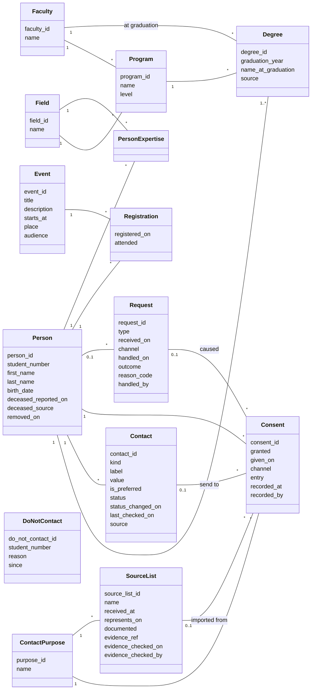

# The model

**Goal of this file:** turn the [story](story.md) into a model: what we store, what we compute, and how we check it.

The story says **what** the university needs. This file says **how** we represent it, in three parts:

| Part | Question | Content |
|---|---|---|
| [1. Store](#1-store) | What do we keep, and how is it organised? | Classes, attributes, relationships, keys |
| [2. Compute](queries.md) | What do we get out of it? | The story's questions, as queries and views (in its own file, [queries.md](queries.md)) |
| [3. Check](#3-check) | How do we know it is right? | Constraints, then quality rules (slice 4) |

Each choice follows the same path: **first idea → the problem it causes → the solution kept.** The full reasoning of each choice is in [DECISIONS.md](../DECISIONS.md).

---

## 1. Store

### 1.1 The classes

`DoNotContact` is linked to nothing, on purpose ([1.4](#14-removal)).

| Class | One row is… | Comes from |
|---|---|---|
| `Faculty` | a faculty of the university | Reference list |
| `Field` | a field of knowledge (civil engineering, mathematics…) | Reference list, shared by programs and expertise |
| `Program` | a study program, at a level (bachelor, master, doctorate…), in one faculty | Registrar |
| `Person` | one graduate, **once**, whatever the number of degrees | Registrar and old spreadsheets, then the alumni office |
| `Degree` | one degree obtained by one person | Registrar copy, or an old spreadsheet (its `source` says which) |
| `Contact` | one email, phone or address of a person | The alumni office |
| `ContactPurpose` | a kind of contact: newsletter, events, assignment offers | Reference list |
| `Consent` | one answer of one person, for one kind of contact | The alumni office |
| `Request` | one request from a person: stop, remove, access, correction | The alumni office |
| `DoNotContact` | one student number that must never be brought back or contacted again, after a removal | The alumni office |
| `Event` | one event: reunion, department event… | The alumni office |
| `Registration` | one person registered to one event, and whether they came | The alumni office |
| `PersonExpertise` | one field in which one person has expertise | The alumni office |
| `SourceList` | one imported consent list, for one kind of contact: when we received it, and whether it proves consent | The alumni office, at import |

**Eight core classes, six supporting ones**
- **The core (8):** `Person`, `Degree`, `Program`, `Contact`, `Consent`, `Request`, `DoNotContact`, `Event`. They hold the information the story is about.
- **Reference lists (3):** `Faculty`, `Field`, `ContactPurpose`. Short lists of allowed values, written once and shared, so that the same thing is never typed two different ways.
- **Association classes (2):** `Registration`, `PersonExpertise`. They exist only to link two classes in a many-to-many relationship, and to hold what belongs to the link itself (for example, whether the person came to the event).
- **Provenance (1):** `SourceList`. It describes where imported answers come from, so that this description is written once per list, not once per answer.

### 1.2 The choices, one by one

**Person and degree: two classes** ([D-014](../DECISIONS.md#d-014--a-person-and-their-degrees-are-two-classes-2026-10-10))
- *First idea:* one table with the person and the degree.
- *Problem:* Karim has two degrees, so he becomes two rows, with his name copied twice. Change it in one row only, and the table itself has created a duplicate.
- *Solution:* `Person` 1 ── 1..* `Degree`. Each fact is stored once. Every person has at least one degree: that is what makes them a graduate.
- *And the same degree twice?* One person cannot have the same program in the same year twice: (`person_id`, `program_id`, `graduation_year`) is unique. Each degree also says where it came from (`source`), so a registrar copy and an old spreadsheet can be told apart. When the registrar row arrives for a degree already loaded from a spreadsheet, it **replaces** the spreadsheet row; a registrar row is never replaced. After the first copy, the registrar sends only the new degrees each year: old degrees are never loaded twice.

**The primary key** ([D-015](../DECISIONS.md#d-015--internal-primary-key-the-student-number-is-an-attribute-2026-10-10))
- *First idea:* the student number as the key (or a code built from the name).
- *Problem:* old spreadsheets have no student number, and a key cannot be empty; the number belongs to the registrar; a code from the name changes with the name.
- *Solution:* `person_id`, an internal number, is the key. `student_number` is an attribute, unique and optional: the best way to **find** a person.

**Faculty: today's, and at graduation** ([D-025](../DECISIONS.md#d-025--faculty-at-graduation-stored-on-each-degree-2026-10-12))
- *First idea:* a degree finds its faculty through its program (`Degree` → `Program` → `Faculty`).
- *Problem:* if a program moves to another faculty in 2028, Karim's 2012 degree moves with it, and the statistics for 2012 change.
- *Solution:* `Degree` also stores the faculty **at graduation**, as given by the registrar. `Program` keeps its faculty **today**. It is not duplication: the two can differ, and each is true for its own date.

**Names**
- `Person` holds the **current** name, used by the office.
- `Degree.name_at_graduation` holds the name printed on the diploma, as given by the registrar. Sophie Roy's degree still says *Sophie Gagnon*: the former name is kept where it belongs, and only the staff who need it see it (part 3).

**Contacts: one row per email, phone or address**
- *First idea:* one text field holding several emails, separated by a special character.
- *Problem:* one cell, several values (this breaks the first normal form). We cannot mark one email *preferred* and another *bounced*, check them one by one, or search them properly.
- *Solution:* `Person` 1 ── * `Contact`. Each contact has its `kind` (email, phone, address), its `label` (university, personal, work), whether it is preferred, its `status` (valid, bounced, unknown) and when that status last changed, when it was last checked, and its `source` (which imported file or which conversation).
- *And the same email twice?* The same value cannot appear twice for the same person and kind (compared after normalising, for example emails in lowercase). Otherwise one copy could be "valid" and the other "bounced".
- *And when Léa changes her email?* The new address is a **new row**; the old one gets the status `obsolete`. A value is never overwritten, so its checks and its bounces stay attached to the right address.

**Consent: the whole history** ([D-016](../DECISIONS.md#d-016--consent-one-row-per-person-per-kind-of-contact-per-answer-2026-10-10))
- *First idea:* one row per person, with one yes/no column per kind of contact.
- *Problem:* the old answer is overwritten. We cannot say since when, or how, the person answered, nor prove it.
- *Solution:* one row per answer: person, kind of contact, yes or no, when the person answered, how they answered, how the record entered our database, and who recorded it. A new answer is a **new row**; old rows are never changed.
- **The table stores the whole history; a view shows the current state** ([queries.md](queries.md)).
- *Two different questions, two attributes* ([D-024](../DECISIONS.md#d-024--consent-the-effective-date-decides-on-the-same-date-no-wins-2026-10-12)). **How did the person answer?** (`channel`: email, phone, letter, unsubscribe link, unknown.) **How did the record enter our database?** (`entry`: typed by the staff; `mailing system`, for individual dated actions such as Karim's unsubscribe; `file import`, for a **snapshot** of a list.) A first version mixed them in one column, and an unsubscribe link (which arrives through Office 365) lost to an older "yes".
- *Where does an imported answer come from?* ([D-028](../DECISIONS.md#d-028--sourcelist-the-description-of-an-imported-list-belongs-to-the-list-2026-10-14))
  - *First idea:* on each imported answer, the date of the list and whether it proves consent.
  - *Problem:* 5,000 answers from the same list repeat the same date and the same "proves consent: yes". If proof is found six months later, 5,000 rows must change: an update anomaly, like Karim's name copied twice.
  - *Solution:* a small class `SourceList`, one row per imported list, for **one** kind of contact (a newsletter sign-up form proves consent to the newsletter, not to assignment offers). It holds the day we received the list, the date its information represents, whether it proves consent, where the proof is, and when and by whom the proof was checked. Each imported answer points to its list. **A snapshot never carries a choice date**: the list says what was true, not when the person chose.
- *Which answer is the current one?* ([D-026](../DECISIONS.md#d-026--consent-three-kinds-of-evidence-2026-10-12)) Three kinds of evidence, three rules:
  1. **The person's own choice**, with its real date: the latest wins; on the same date, "no" wins. Karim's unsubscribe (March) beats his "yes" (January).
  2. **A "no" from a list** blocks contact from the day we receive the list. Only a **later** choice by the person can lift it.
  3. **A "yes" from a list** counts only when there is nothing else, and only if the list documents a real consent (the newsletter sign-up form does; a reunion spreadsheet does not). Otherwise the answer is **unknown**: nothing is sent, and the person is asked to confirm.
  - In one sentence: **an old "yes" can never cancel a "no", and a "yes" we cannot justify is not enough to send.**
- *Where to send it?* A consent may name one contact (`contact_id`) of **the same person**: "newsletter to my personal email, offers to my work email". It must be an **email**. Empty: the preferred email. If the chosen address no longer works (`bounced` or `obsolete`), **we do not send** this kind of message, and the staff are alerted to ask the person again: Léa said "only my personal email", so another address would go against her choice.

**Requests: a fact of their own**
- *First idea:* an "asked to be removed" column, with a date, on the person.
- *Problem:* a person may make several requests (stop, then access, then removal), and after a removal the column would disappear with the rest.
- *Solution:* a `Request` class: type, date received, channel, and once handled: date, outcome (done, partly done, refused), a reason **code** and who handled it. A code, not free text: free text could end up holding a name. "Each request is checked" (story) and "prove it" (question 9) have their home here. After a removal, the kept requests no longer say for whom (1.4). When Robert says "stop everything", one `Request` row produces three `Consent` rows ("no"), each pointing to that request: we can always trace why an answer changed.

**Events: who registered, who came**
- *First idea:* `Event` alone, with no link to people; the invitation list is just a query.
- *Problem:* the story asks to record who registered and who came. That is a link between people and events, many to many.
- *Solution:* the association class `Registration` (person, event, registration date, attended yes/no). *Whom to invite* stays a query ([queries.md](queries.md)): `audience` describes the target in words, and the list is computed with parameters chosen when it is prepared (a program, a faculty or a field, a range of years, or everyone).

**Expertise: several fields per person** ([D-017](../DECISIONS.md#d-017--fields-of-expertise-many-per-person-from-a-shared-list-2026-10-10))
- *First idea:* one free-text "expertise" on the person.
- *Problem:* one value only, and "civil engineering" typed five different ways.
- *Solution:* `Person` *──* `Field` through `PersonExpertise`. `Field` is shared with programs, so matching an offer to a person is a join.

**Death**
- *Solution:* two attributes on `Person`: the date it was reported, and how we learned it (family, returned letter, obituary). When the date is filled, the person receives nothing (part 3). A reported death counts as "stop everything": it survives a removal (1.4).

**Birth date — why keep it?**
- It comes with the registrar's copy (story), and some old spreadsheets have it. Two different people can have the same name and the same graduation year; the birth date tells them apart when we look for duplicates (slice 4). The law asks us to keep only what is necessary; this is the reason it is necessary. It stays optional (old entries may not have it), and it is seen only by the staff who look for duplicates (part 3).

### 1.3 Data dictionary: every attribute explained

**How to read it**
- **Type:** the planned PostgreSQL type. The final choice is made in `sql/schema.sql` (slice 2).
- **Req.** (required): `*` = the value must always be there (`NOT NULL`); empty = the value may be missing.
- **Links** (`… → Class`): the column that points to another class (a foreign key). The class diagram does not show these columns; the tables do.
- **Identifiers** (`…_id`): an internal whole number, created automatically, with no meaning outside our system ([D-015](../DECISIONS.md#d-015--internal-primary-key-the-student-number-is-an-attribute-2026-10-10)).

**Two ways to limit a value to a list** (a choice to confirm in slice 2)
- A **reference class** (`Faculty`, `Field`, `ContactPurpose`) when the list grows over time, is managed by the staff, or is shared by several classes.
- A **fixed list** checked by the database (`CHECK`) when the list is short and only changes with the model: `kind`, `status`, `type`, `outcome`…

#### `Faculty` — the faculties of the university

| Attribute | Type | Req. | Purpose |
|---|---|---|---|
| `faculty_id` | integer | * | Identifier |
| `name` | text | * | "Faculty of Engineering". Unique: the same faculty is never written twice |

#### `Field` — fields of knowledge, shared by programs and expertise

| Attribute | Type | Req. | Purpose |
|---|---|---|---|
| `field_id` | integer | * | Identifier |
| `name` | text | * | "Civil engineering", "Mathematics". Unique |

#### `Program` — a study program, at one level, in one faculty

| Attribute | Type | Req. | Purpose |
|---|---|---|---|
| `program_id` | integer | * | Identifier |
| `name` | text | * | "Bachelor of Civil Engineering" |
| `level` | text | * | `bachelor`, `master`, `doctorate`, `certificate`. Lets us count by level |
| `faculty_id` | → `Faculty` | * | The faculty that offers it **today** |
| `field_id` | → `Field` | * | Its field: an assignment offer in civil engineering reaches its graduates. **Assumption:** a program's field does not change (unlike its faculty, D-025) |

#### `Person` — one graduate, once, whatever the number of degrees

| Attribute | Type | Req. | Purpose |
|---|---|---|---|
| `person_id` | integer | * | Identifier (the key; never shown outside the system) |
| `student_number` | text |  | Given by the registrar, for life. Unique when present; empty in old spreadsheets. **Text, not a number:** it may start with zeros or contain letters, and we never calculate with it |
| `first_name` | text | * ¹ | Current first name, used by the office |
| `last_name` | text | * ¹ | Current family name |
| `birth_date` | date |  | From the registrar's copy or an old spreadsheet. Tells apart two people with the same name and year (duplicates, slice 4) |
| `deceased_reported_on` | date |  | Date we learned of the death. **Filled = no contact at all** |
| `deceased_source` | text |  | How we learned it: `family`, `returned mail`, `obituary`. Filled if and only if the date is filled |
| `removed_on` | date |  | Date the person's information was removed (1.4). If filled, every identifying attribute is empty |

¹ Required, except after a removal (part 3).

#### `Degree` — one degree obtained by one person

| Attribute | Type | Req. | Purpose |
|---|---|---|---|
| `degree_id` | integer | * | Identifier |
| `person_id` | → `Person` | * | Who obtained it |
| `program_id` | → `Program` | * | Which program (and through it, which level and field) |
| `faculty_id` | → `Faculty` | * | The faculty **at graduation**, as given by the registrar. Statistics by faculty use this one ([D-025](../DECISIONS.md#d-025--faculty-at-graduation-stored-on-each-degree-2026-10-12)) |
| `graduation_year` | integer | * | Year of graduation: the most frequent filter in statistics |
| `name_at_graduation` | text |  | Name printed on the diploma. Keeps the former name (Sophie *Gagnon*) where it belongs. Emptied on removal |
| `source` | text | * | `registrar`, or the name of the old spreadsheet it came from. The office never corrects a registrar row. After a removal: only `registrar` or `spreadsheet`, without the file name |

(`person_id`, `program_id`, `graduation_year`) is unique: the same degree cannot be counted twice for the same person.

#### `Contact` — one email, phone or address of one person

| Attribute | Type | Req. | Purpose |
|---|---|---|---|
| `contact_id` | integer | * | Identifier |
| `person_id` | → `Person` | * | Whose contact it is |
| `kind` | text | * | `email`, `phone`, `address` |
| `label` | text | * | `university`, `personal`, `work`: Léa's university email is not her personal one |
| `value` | text | * | The address or number itself |
| `is_preferred` | boolean | * | The one to use first. At most one per person and per kind (part 3). A `bounced` or `obsolete` contact cannot stay preferred. Default: no |
| `status` | text | * | `valid`, `bounced`, `unknown`, `obsolete` (replaced by a newer address). Office 365 bounces set `bounced`. Default: `unknown` |
| `status_changed_on` | date |  | When the status last changed: tells us *when* an address started to bounce |
| `last_checked_on` | date |  | Last time it was confirmed or a message to it was delivered. Answers story question 5 |
| `source` | text | * | Where it came from: an imported file's name, "phone call", "email from the person". Needed to judge and improve quality |

(`person_id`, `kind`, `value`) is unique, after normalising the value.

#### `ContactPurpose` — the kinds of contact a person can accept or refuse

| Attribute | Type | Req. | Purpose |
|---|---|---|---|
| `purpose_id` | integer | * | Identifier |
| `name` | text | * | `newsletter`, `events`, `assignment offers`. Unique. A new kind is one new row |

#### `Consent` — one answer of one person, for one kind of contact (history)

| Attribute | Type | Req. | Purpose |
|---|---|---|---|
| `consent_id` | integer | * | Identifier |
| `person_id` | → `Person` | * | Who answered |
| `purpose_id` | → `ContactPurpose` | * | For what |
| `granted` | boolean | * | Yes or no |
| `given_on` | date | ² | The day the person **made the choice**: story question 6, and the proof the law asks for |
| `channel` | text | * | **How the person answered:** `email`, `phone`, `letter`, `unsubscribe link`, `unknown` |
| `entry` | text | * | **How the record entered our database:** `staff` (typed), `mailing system` (an individual dated action from Office 365), `file import` (a snapshot of a list) |
| `source_list_id` | → `SourceList` | ³ | For a `file import`: the list it comes from. Its kind of contact must be this answer's kind (the link checks `source_list_id` and `purpose_id` together) |
| `recorded_at` | date and time | * | When we recorded it. Last tie-breaker between two answers |
| `recorded_by` | text | * | Which staff member, or which import, entered it. Becomes a link to a staff account in slice 5 |
| `contact_id` | → `Contact` |  | Where to send this kind of message. Must be an email of the same person (the link checks `contact_id` and `person_id` together). Empty = the preferred email. Not working = not sent |
| `request_id` | → `Request` |  | The request that caused this answer, if any ("stop everything") |

² Filled for the person's own choices (`staff`, `mailing system`); **always empty** for a `file import`: a snapshot never carries a choice date.
³ Filled if and only if `entry` = `file import`.

#### `SourceList` — one imported consent list, for one kind of contact

| Attribute | Type | Req. | Purpose |
|---|---|---|---|
| `source_list_id` | integer | * | Identifier |
| `name` | text | * | The file or list: "Newsletter sign-ups 2019" |
| `purpose_id` | → `ContactPurpose` | * | The one kind of contact this list is about. A file covering several kinds is split into several lists during staging |
| `received_at` | date and time | * | When the office **received** the list. A "no" from this list blocks contact from this day |
| `represents_on` | date |  | The date the list's information represents, if known. **Never** taken as the day of anyone's choice; never the export date |
| `documented` | boolean | * | Does the list prove a real, specific consent for its kind of contact? Default: no. A "yes" from an undocumented list does not count |
| `evidence_ref` | text | ⁵ | Where the proof is: "Sign-up forms 2019, archive box 12" |
| `evidence_checked_on` | date | ⁵ | When the proof was checked. Proof found later is recorded here, without changing any answer |
| `evidence_checked_by` | text | ⁵ | Who checked it |

⁵ Filled if and only if `documented` is yes.

#### `Request` — one request made by a person

| Attribute | Type | Req. | Purpose |
|---|---|---|---|
| `request_id` | integer | * | Identifier |
| `person_id` | → `Person` | * ⁴ | Who asked |
| `type` | text | * | `stop`, `remove`, `access`, `correction` |
| `received_on` | date | * | Date received: the legal deadline starts here |
| `channel` | text | * | `email`, `phone`, `letter`. An `access` or `correction` request must be **in writing** (`email` or `letter`). A first phone call about it is handled outside this model, until the written request arrives |
| `handled_on` | date |  | Date it was completed. **Empty = still open**: one query lists every late request |
| `outcome` | text |  | `done`, `partly done`, `refused`. Filled when handled |
| `reason_code` | text |  | Why, when partly done or refused: `kept by law`, `identity not verified`, `not held by the office`, `other`. A code, never free text |
| `handled_by` | text |  | Which staff member decided. Filled when handled. Becomes a link to a staff account in slice 5 |

⁴ Required, except after the person's removal: the kept requests are then detached (1.4).

#### `DoNotContact` — student numbers that must never be brought back or contacted again, after a removal

| Attribute | Type | Req. | Purpose |
|---|---|---|---|
| `do_not_contact_id` | integer | * | Identifier |
| `student_number` | text | * | The only thing kept. Unique. Checked at every import |
| `reason` | text | * | `deceased` (a death was reported), `stop` (a stop request exists) or `removed` (otherwise). One reason per number: `deceased` wins over `stop`, `stop` over `removed` |
| `since` | date | * | Since when, for the reason kept: the day the death was reported (`deceased`), the day of the stop request (`stop`), or the day of the removal (`removed`) |

No link to `Person`, `Degree` or `Request`, on purpose. The list means **never contact, for anything**: at removal, any "stop", even partial, becomes total.

#### `Event` — one event organised by the office

| Attribute | Type | Req. | Purpose |
|---|---|---|---|
| `event_id` | integer | * | Identifier |
| `title` | text | * | "Annual reunion 2026" |
| `description` | text |  | Free text for the invitation |
| `starts_at` | date and time | * | When |
| `place` | text |  | Where. Empty until decided |
| `audience` | text |  | Who is targeted, in words: "Mathematics graduates 2010–2015". The list itself is computed ([queries.md](queries.md)) |

#### `Registration` — one person registered to one event (association class)

| Attribute | Type | Req. | Purpose |
|---|---|---|---|
| `person_id` | → `Person` | * | Who |
| `event_id` | → `Event` | * | Which event |
| `registered_on` | date |  | When they registered. Empty when only the paper list at the door is known |
| `attended` | boolean |  | Did they come? **Empty = not known yet** (the event has not happened, or the list at the door was not entered) |

The key is the pair (`person_id`, `event_id`): a person registers only once to the same event.

#### `PersonExpertise` — one field in which one person has expertise (association class)

| Attribute | Type | Req. | Purpose |
|---|---|---|---|
| `person_id` | → `Person` | * | Who |
| `field_id` | → `Field` | * | Which field |

The key is the pair (`person_id`, `field_id`): the same field is not recorded twice for the same person.

### 1.4 Removal

**Three words, three different things** ([D-022](../DECISIONS.md#d-022--removal-is-de-identification-plus-a-suppression-list-not-anonymisation-2026-10-12))
- **Removal:** we delete the information the policy allows us to delete.
- **Suppression list:** we keep one restricted identifier (the student number), alone, only to recognise the person if they come back in an import, and never contact them.
- **Anonymisation:** what remains no longer allows anyone to identify the person, directly or indirectly. **Our removal does not reach this level**, and we say so.

When a person asks us to remove their information (and nothing requires us to keep it):

| What | Happens |
|---|---|
| `Contact`, `Consent`, `Registration`, `PersonExpertise` rows | **Deleted** |
| `Person`: names, student number, birth date, death information | **Emptied**; `removed_on` receives the date |
| `Degree.name_at_graduation` | **Emptied**; `Degree.source` keeps only `registrar` or `spreadsheet` |
| `Person` row (`person_id`), `Degree` rows (program, faculty, year) | **Kept**: the totals do not change |
| `Request` rows | **Kept, but detached** (`person_id` emptied): they prove what was done, by whom and with what outcome, without saying for whom |
| The student number | **Moved alone into the suppression list (`DoNotContact`)**, with the reason and the date |

*Why every removal goes into the list* ([D-019](../DECISIONS.md#d-019--removal-and-the-do-not-contact-list-2026-10-10)): with the student number emptied, the next import could not recognise the person; they would come back with their full identity, and their degrees would be counted twice. **This is a policy choice of the office**, not an automatic consequence of removal: the list must be justified, seen only by the staff who run imports, and kept only as long as the policy says (to define).

*Why a separate list, and detached requests?* If the number stayed on the `Person` row, or if a kept request still pointed to the person, the kept degrees could be joined back: student number + program + year identifies the person again.

*When a listed number comes back* ([D-023](../DECISIONS.md#d-023--a-new-degree-for-a-listed-number-is-ignored-2026-10-12)): old spreadsheets are imported once, and the registrar then sends only new degrees, so anything arriving later is new. **It is ignored**: a listed number never enters again, for anything. A number leaves the list only if the person asks.

*Honest limits:*
- **Not anonymous.** In a very small program, "civil engineering, 2003" can point to one person. The kept degree rows are *de-identified*, not anonymous.
- A degree earned after the removal is **not counted**. Rare, and accepted.
- A person without a student number cannot be recognised after removal.
- Dates can still hint at a link (a removal date and a list date on the same day). A real project would ask the privacy officer.
- Removal covers **this database only**. The archived spreadsheets follow the university's retention rules, and copies in other systems (Office 365) are outside the model.

### 1.5 Left for later, on purpose

([D-021](../DECISIONS.md#d-021--left-for-later-on-purpose-2026-10-10))
- **Staging tables (slices 3–4).** Old spreadsheets are first loaded as they are into temporary tables, cleaned, checked, then moved into the model. That is why "M. Tremblay" without a first name does not block anything: he never enters `Person` uncleaned.
- **A safety rule, already decided:** a record whose identity is not confirmed (possible duplicate, or not yet checked against the suppression list) **never enters a mailing list**. Otherwise Robert, imported again under a slightly different name, would come back as a new person without his "stop".
- **Duplicate decisions and merges (slice 4).** Where a staff member's decision "same person / not the same person" is kept, and how two `Person` rows are merged (moving their contacts, consents and requests).
- **Quality over time (slice 4).** Question 10 ("better or worse, month after month?") needs past measurements; they will be stored as dated measurements.
- **Invitation history.** Today we compute who *may* be invited; we do not store who *was* invited to a past event. Noted for later.

---

## 2. Compute

Part 2 has its own file: **[queries.md](queries.md)**. It takes each question of the story, explains it with a small example, then gives the SQL and the expected result on a cast of six people.

---

## 3. Check

**A rule written here is not yet a rule the database enforces.** Each rule below says **how** it will be enforced, and when.

| How | Meaning |
|---|---|
| **Constraint** | The database refuses the bad row (`NOT NULL`, `UNIQUE`, `CHECK`, foreign key). The strongest |
| **Index** | A partial unique index: unique only among some rows (for example, only the preferred ones) |
| **View** | The rule is written once in a view; every list reads the view |
| **Trigger** | A small program the database runs on each change, when a constraint cannot look at another table |
| **Process** | The import or removal procedure applies it, in one transaction |
| **Test** | A check query whose correct answer is empty, run after each import or removal |
| **Rights** | Only some roles may see or change it (slice 5) |

| Rule | How | When |
|---|---|---|
| No consent means no: a person with no answer for a kind of contact is not contacted | View (`recipient`) | Slice 2 |
| The current answer follows the three kinds of evidence (D-026) | View (`current_consent`) | Slice 2 |
| An undocumented "yes" from a list does not count; the person is asked to confirm | View, list of answers to confirm | Slice 2 |
| An imported answer points to its list, and only an imported one; it never carries a `given_on`; the person's own choices always do | Constraint | Slice 2 |
| An imported answer's kind of contact is its list's kind | Constraint (link on two columns) | Slice 2 |
| A documented list has its proof reference, check date and checker | Constraint | Slice 2 |
| History is never changed: consent and request rows are only added (except removal, and filling in a request's handling) | Rights | Slice 5 |
| A contact's value is never overwritten: a new address is a new row | Rights, process | Slices 2, 5 |
| A death closes all contact | View (`active_person`) | Slice 2 |
| `deceased_source` is filled if and only if `deceased_reported_on` is filled | Constraint | Slice 2 |
| At most one preferred contact per person and per kind | Index | Slice 2 |
| A `bounced` or `obsolete` contact is never preferred | Constraint | Slice 2 |
| A consent's chosen contact belongs to the same person | Constraint (link on two columns) | Slice 2 |
| …and is an email | Trigger | Slice 2 |
| The same degree is not stored twice (person, program, year) | Constraint | Slice 2 |
| The same contact is not stored twice (person, kind, normalised value) | Index | Slice 2 |
| A handled request is complete: `outcome` and `handled_by` filled if and only if `handled_on` is filled | Constraint | Slice 2 |
| An access or correction request is in writing (`email` or `letter`) | Constraint | Slice 2 |
| Every person has at least one degree | Process, test (a plain foreign key cannot enforce it) | Slices 2–3 |
| Removal empties everything listed in 1.4, and detaches the requests | Process (one transaction), test ([Q9](queries.md#q9--a-removal-done-verified-totals-unchanged)) | Slice 2 |
| Names are filled for every person not removed | Constraint | Slice 2 |
| A listed number never enters again | Process | Slice 3 |
| A record whose identity is not confirmed never enters a mailing list | Process (staging) | Slices 3–4 |
| The registrar's row replaces a spreadsheet row for the same degree, and is never replaced | Process | Slice 3 |
| The access report covers every class that points to a person | Test (compare the report with the list of tables that have a `person_id`) | Slice 2 |
| Former names, home addresses and birth dates are seen only by the staff who need them | Rights | Slice 5 |
