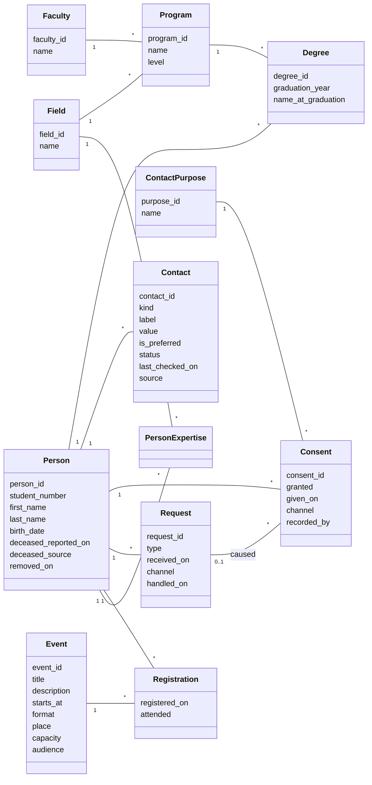

# The model

**Goal of this file:** turn the [story](story.md) into a model: what we store, what we compute, and how we check it.

The story says **what** the university needs. This file says **how** we represent it, in three parts:

| Part | Question | Content |
|---|---|---|
| [1. Store](#1-store) | What do we keep, and how is it organised? | Classes, attributes, relationships, keys |
| [2. Compute](#2-compute) | What do we get out of it? | The story's questions, as queries and views |
| [3. Check](#3-check) | How do we know it is right? | Constraints, then quality rules (slice 4) |

Each choice follows the same path: **first idea → the problem it causes → the solution kept.** The full reasoning of each choice is in [DECISIONS.md](../DECISIONS.md).

---

## 1. Store

### 1.1 The classes

| Class | One row is… | Comes from |
|---|---|---|
| `Faculty` | a faculty of the university | Reference list |
| `Field` | a field of knowledge (civil engineering, mathematics…) | Reference list, shared by programs and expertise |
| `Program` | a study program, at a level (bachelor, master, doctorate…), in one faculty | Registrar |
| `Person` | one graduate, **once**, whatever the number of degrees | Registrar, then the alumni office |
| `Degree` | one degree obtained by one person | Registrar (copy; the office never changes it) |
| `Contact` | one email, phone or address of a person | The alumni office |
| `ContactPurpose` | a kind of contact: newsletter, events, assignment offers | Reference list |
| `Consent` | one answer of one person, for one kind of contact, at one date | The alumni office |
| `Request` | one request from a person: stop, remove, access, correction | The alumni office |
| `Event` | one event: reunion, department event… | The alumni office |
| `Registration` | one person registered to one event, and whether they came | The alumni office |
| `PersonExpertise` | one field in which one person has expertise | The alumni office |

**Seven core classes, five supporting ones**
- **The core (7):** `Person`, `Degree`, `Program`, `Contact`, `Consent`, `Request`, `Event`. They hold the information the story is about.
- **Reference lists (3):** `Faculty`, `Field`, `ContactPurpose`. Short lists of allowed values, written once and shared, so that the same thing is never typed two different ways.
- **Association classes (2):** `Registration`, `PersonExpertise`. They exist only to link two classes in a many-to-many relationship, and to hold what belongs to the link itself (for example, whether the person came to the event).

### 1.2 The choices, one by one

**Person and degree: two classes** ([D-014](../DECISIONS.md#d-014--a-person-and-their-degrees-are-two-classes-2026-10-10))
- *First idea:* one table with the person and the degree.
- *Problem:* Karim has two degrees, so he becomes two rows, with his name copied twice. Change it in one row only, and the table itself has created a duplicate.
- *Solution:* `Person` 1 ── 0..* `Degree`. Each fact is stored once.

**The primary key** ([D-015](../DECISIONS.md#d-015--internal-primary-key-the-student-number-is-an-attribute-2026-10-10))
- *First idea:* the student number as the key (or a code built from the name).
- *Problem:* old spreadsheets have no student number, and a key cannot be empty; the number belongs to the registrar; a code from the name changes with the name.
- *Solution:* `person_id`, an internal number, is the key. `student_number` is an attribute, unique and optional: the best way to **find** a person.

**Names**
- `Person` holds the **current** name, used by the office.
- `Degree.name_at_graduation` holds the name printed on the diploma, as given by the registrar. Sophie Roy's degree still says *Sophie Gagnon*: the former name is kept where it belongs, and only the staff who need it see it (part 3).

**Contacts: one row per email, phone or address**
- *First idea:* one text field holding several emails, separated by a special character.
- *Problem:* one cell, several values (this breaks the first normal form). We cannot mark one email *preferred* and another *bounced*, check them one by one, or search them properly.
- *Solution:* `Person` 1 ── * `Contact`. Each contact has its `kind` (email, phone, address), its `label` (university, personal, work), whether it is preferred, its `status` (valid, bounced, unknown), when it was last checked, and its `source` (which imported file or which conversation).

**Consent: the whole history** ([D-016](../DECISIONS.md#d-016--consent-one-row-per-person-per-kind-of-contact-per-answer-2026-10-10))
- *First idea:* one row per person, with one yes/no column per kind of contact.
- *Problem:* the old answer is overwritten. We cannot say since when, or how, the person answered, nor prove it.
- *Solution:* one row per answer: person, kind of contact, yes or no, date, channel, who recorded it. A new answer is a **new row**; old rows are never changed.
- **The table stores the whole history; a view shows the current state** (part 2).

**Requests: a fact of their own**
- *First idea:* an "asked to be removed" column, with a date, on the person.
- *Problem:* a person may make several requests (stop, then access, then removal), and after a removal the column would disappear with the rest.
- *Solution:* a `Request` class: type, date received, channel, date handled. When Robert says "stop everything", one `Request` row produces three `Consent` rows ("no"), each pointing to that request: we can always trace why an answer changed.

**Events: who registered, who came**
- *First idea:* `Event` alone, with no link to people; the invitation list is just a query.
- *Problem:* the story asks to record who registered and who came. That is a link between people and events, many to many.
- *Solution:* the association class `Registration` (person, event, registration date, attended yes/no). *Whom to invite* stays a query (part 2).

**Expertise: several fields per person** ([D-017](../DECISIONS.md#d-017--fields-of-expertise-many-per-person-from-a-shared-list-2026-10-10))
- *First idea:* one free-text "expertise" on the person.
- *Problem:* one value only, and "civil engineering" typed five different ways.
- *Solution:* `Person` *──* `Field` through `PersonExpertise`. `Field` is shared with programs, so matching an offer to a person is a join.

**Death**
- *Solution:* two attributes on `Person`: the date it was reported, and how we learned it (family, returned letter, obituary). When the date is filled, the person receives nothing (part 3).

**Birth date — why keep it?**
- Two different people can have the same name and the same graduation year. The birth date tells them apart when we look for duplicates (slice 4). The law asks us to keep only what is necessary; this is the reason it is necessary.

### 1.3 Data dictionary: every attribute explained

**How to read it**
- **Type:** the planned PostgreSQL type. The final choice is made in `sql/schema.sql` (slice 2).
- **Req.** (required): `*` = the value must always be there (`NOT NULL`); empty = the value may be missing.
- **Links** (`… → Class`): the column that points to another class (a foreign key). The class diagram does not show these columns; the tables do.
- **Identifiers** (`…_id`): an internal whole number, created automatically, with no meaning outside our system ([D-015](../DECISIONS.md#d-015--internal-primary-key-the-student-number-is-an-attribute-2026-10-10)).

**Two ways to limit a value to a list** (a choice to confirm in slice 2)
- A **reference class** (`Faculty`, `Field`, `ContactPurpose`) when the list grows over time, is managed by the staff, or is shared by several classes.
- A **fixed list** checked by the database (`CHECK`) when the list is short and only changes with the model: `kind`, `status`, `type`, `format`…

#### `Faculty` — the faculties of the university

| Attribute | Type | Req. | Purpose |
|---|---|---|---|
| `faculty_id` | integer | * | Identifier |
| `name` | text | * | "Faculty of Engineering". Unique: the same faculty is never written twice |

#### `Field` — fields of knowledge, shared by programs and expertise

| Attribute | Type | Req. | Purpose |
|---|---|---|---|
| `field_id` | integer | * | Identifier |
| `name` | text | * | "Civil engineering", "Mathematics". Unique |

#### `Program` — a study program, at one level, in one faculty

| Attribute | Type | Req. | Purpose |
|---|---|---|---|
| `program_id` | integer | * | Identifier |
| `name` | text | * | "Bachelor of Civil Engineering" |
| `level` | text | * | `bachelor`, `master`, `doctorate`, `certificate`. Lets us count by level |
| `faculty_id` | → `Faculty` | * | The faculty that offers it: department and faculty events target programs |
| `field_id` | → `Field` | * | Its field: an assignment offer in civil engineering reaches its graduates |

#### `Person` — one graduate, once, whatever the number of degrees

| Attribute | Type | Req. | Purpose |
|---|---|---|---|
| `person_id` | integer | * | Identifier (the key; never shown outside the system) |
| `student_number` | text |  | Given by the registrar, for life. Unique when present; empty in old spreadsheets. **Text, not a number:** it may start with zeros or contain letters, and we never calculate with it |
| `first_name` | text | * ¹ | Current first name, used by the office |
| `last_name` | text | * ¹ | Current family name |
| `birth_date` | date |  | Tells apart two people with the same name and year (duplicates, slice 4). Empty when unknown |
| `deceased_reported_on` | date |  | Date we learned of the death. **Filled = no contact at all** |
| `deceased_source` | text |  | How we learned it: `family`, `returned mail`, `obituary` |
| `removed_on` | date |  | Date the person's information was removed (1.4). Filled = names and birth date are empty |

¹ Required, except after a removal: a rule in part 3 says "names are empty **if and only if** `removed_on` is filled".

#### `Degree` — one degree obtained by one person (copied from the registrar)

| Attribute | Type | Req. | Purpose |
|---|---|---|---|
| `degree_id` | integer | * | Identifier |
| `person_id` | → `Person` | * | Who obtained it |
| `program_id` | → `Program` | * | Which program (and through it, which faculty, level and field) |
| `graduation_year` | integer | * | Year of graduation: the most frequent filter in statistics |
| `name_at_graduation` | text |  | Name printed on the diploma. Keeps the former name (Sophie *Gagnon*) where it belongs |

#### `Contact` — one email, phone or address of one person

| Attribute | Type | Req. | Purpose |
|---|---|---|---|
| `contact_id` | integer | * | Identifier |
| `person_id` | → `Person` | * | Whose contact it is |
| `kind` | text | * | `email`, `phone`, `address` |
| `label` | text | * | `university`, `personal`, `work`: Léa's university email is not her personal one |
| `value` | text | * | The address or number itself |
| `is_preferred` | boolean | * | The one to use first. At most one per person and per kind (part 3). Default: no |
| `status` | text | * | `valid`, `bounced`, `unknown`. Office 365 bounces set `bounced`. Default: `unknown` |
| `last_checked_on` | date |  | Last time it was confirmed or a message to it was delivered. Answers story question 5 |
| `source` | text | * | Where it came from: an imported file's name, "phone call", "email from the person". Needed to judge and improve quality |

#### `ContactPurpose` — the kinds of contact a person can accept or refuse

| Attribute | Type | Req. | Purpose |
|---|---|---|---|
| `purpose_id` | integer | * | Identifier |
| `name` | text | * | `newsletter`, `events`, `assignment offers`. Unique. A new kind is one new row |

#### `Consent` — one answer of one person, for one kind of contact, at one date (history)

| Attribute | Type | Req. | Purpose |
|---|---|---|---|
| `consent_id` | integer | * | Identifier |
| `person_id` | → `Person` | * | Who answered |
| `purpose_id` | → `ContactPurpose` | * | For what |
| `granted` | boolean | * | Yes or no |
| `given_on` | date | * | Since when: story question 6, and the proof the law asks for |
| `channel` | text | * | How: `form`, `email`, `phone`, `letter`, `import` |
| `recorded_by` | text | * | Which staff member entered it. Becomes a link to a staff account in slice 5 |
| `request_id` | → `Request` |  | The request that caused this answer, if any ("stop everything") |

#### `Request` — one request made by a person

| Attribute | Type | Req. | Purpose |
|---|---|---|---|
| `request_id` | integer | * | Identifier |
| `person_id` | → `Person` | * | Who asked |
| `type` | text | * | `stop`, `remove`, `access`, `correction` |
| `received_on` | date | * | Date received: the legal deadline starts here |
| `channel` | text | * | `email`, `phone`, `letter` |
| `handled_on` | date |  | Date it was completed. **Empty = still open**: one query lists every late request |

#### `Event` — one event organised by the office

| Attribute | Type | Req. | Purpose |
|---|---|---|---|
| `event_id` | integer | * | Identifier |
| `title` | text | * | "Annual reunion 2026" |
| `description` | text |  | Free text for the invitation |
| `starts_at` | date and time, with time zone | * | When. With the time zone, an online event is clear for everyone |
| `format` | text | * | `in person`, `online`, `hybrid` |
| `place` | text |  | Where. Empty for an online event |
| `capacity` | integer |  | Maximum number of people. Empty = no limit. Must be above zero |
| `audience` | text |  | Who is targeted, in words: "Mathematics graduates 2010–2015". The list itself is computed (part 2) |

#### `Registration` — one person registered to one event (association class)

| Attribute | Type | Req. | Purpose |
|---|---|---|---|
| `person_id` | → `Person` | * | Who |
| `event_id` | → `Event` | * | Which event |
| `registered_on` | date | * | When they registered |
| `attended` | boolean |  | Did they come? **Empty = not known yet** (the event has not happened, or the list at the door was not entered) |

The key is the pair (`person_id`, `event_id`): a person registers only once to the same event.

#### `PersonExpertise` — one field in which one person has expertise (association class)

| Attribute | Type | Req. | Purpose |
|---|---|---|---|
| `person_id` | → `Person` | * | Who |
| `field_id` | → `Field` | * | Which field |

The key is the pair (`person_id`, `field_id`): the same field is not recorded twice for the same person.

### 1.4 Removal

When a person asks us to remove their information (and nothing requires us to keep it):
- deleted: their `Contact`, `Consent` (unless they also said "stop"), `Registration` and `PersonExpertise` rows;
- emptied on `Person`: names, birth date and death information; `removed_on` receives the date;
- kept: the `Person` row with its `person_id`, and its `Degree` rows, so the totals do not change; the `Request` row, as the trace that the removal was done;
- if they also said "stop": `student_number` and their "no" consent rows are kept, so an imported spreadsheet cannot bring them back.

> **To check:** `Degree.name_at_graduation` also identifies the person. On removal, it must be emptied too, or replaced by the anonymous totals it feeds.

---

## 2. Compute

*To be completed.* First elements already agreed:

- **View `current_consent`:** the most recent answer for each person and each kind of contact. Every other query reads this view, never the history table directly.
- **View "people to invite":** alive, at least one working contact, current consent "yes" for events — **one row per person**, even with two degrees.
- **Counting:** people (`Person`) and degrees (`Degree`) are two different totals; the story asks for both.

---

## 3. Check

*To be completed.* First rules already agreed:

- **No consent means no.** No row for a kind of contact: the person is not contacted (opt-in).
- **History is never changed.** `Consent` and `Request` rows are only added, never modified (except for a removal).
- **A death closes all contact.** A person with a reported death appears in no list.
- **One preferred contact** per person and per kind (email, phone).
- **Names and removal go together.** A person's names are empty if and only if `removed_on` is filled.
- **Confidentiality:** former names and home addresses are seen only by the staff who need them (roles, slice 5).
